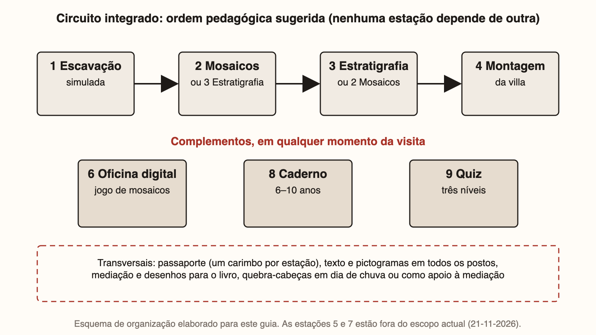

> © 2026 Fernando Rodrigues de Jácomo. Produzido no âmbito do Projecto Comunitário de Milreu. Consultar `RIGHTS.md`.

# Abertura. O Circuito Educativo e este guia

## 1. O que é o Circuito Educativo

O Circuito Educativo – Ruínas Romanas de Milreu é um conjunto de actividades práticas, pensado para levar a escolas, museus, eventos e, quando houver autorização, às próprias ruínas alguns dos procedimentos com que a arqueologia conhece o passado e alguns dos conteúdos que a investigação já estabeleceu sobre a villa romana de Milreu, em Estoi. Cada actividade gira à volta de objectos que se manipulam, montam, comparam e registam: uma moldura de escavação com réplicas enterradas, tesselas para compor um mosaico, camadas que se empilham para formar um perfil, edifícios que se encaixam sobre uma planta. O objectivo declarado nos documentos de concepção não é transmitir uma lista de informações sobre a villa, mas pôr as pessoas a observar, a decidir, a comparar e a justificar uma interpretação, de modo a tornar inteligível a relação entre vestígios, espaços, pessoas e transformações históricas.

O Circuito tem sete actividades, que este guia trata como estações e que conservam a numeração dos documentos de concepção: escavação simulada (1), oficina de mosaicos (2), oficina de estratigrafia (3), montagem da villa (4), oficina digital (6), caderno de actividades (8) e quiz histórico (9). Em 21 de novembro de 2026, o investigador decidiu reduzir o escopo, porque as actividades previstas eram demasiadas para uma só pessoa preparar e conduzir. Ficaram fora do escopo actual a estação 5, Laboratório de Numismática, a estação 7, caça ao tesouro nas ruínas, e o jogo de construção da villa que a oficina digital previa, que passa a ter apenas o jogo de mosaicos. Os números 5 e 7 não foram reatribuídos, para que as referências aos documentos de concepção e os códigos dos materiais continuem a corresponder às mesmas actividades. As cinco primeiras estações são físicas ou digitais e podem funcionar de forma independente; o caderno e o quiz foram concebidos como componentes complementares, com condições de uso próprias, e não como estações equivalentes às outras. Em 21 de novembro de 2026 juntaram-se quatro componentes, que o guia identifica por letras: A, mediação cultural e livro com os desenhos das crianças; B, passaporte do Circuito; C, quebra-cabeças; e D, componente para adolescentes. A acessibilidade, que nos documentos de trabalho aparece como componente E, não tem capítulo próprio, porque é tratada dentro de cada actividade, na secção dedicada às adaptações.

O Circuito está planeado e não executado. Em 21 de novembro de 2026 nenhuma das actividades foi aplicada com público, nenhuma duração foi medida e nenhuma lotação foi validada. Existe documentação de concepção consolidada entre 18 e 21 de novembro de 2026, existe a impressora 3D do investigador, com a qual foi produzido um modelo interpretativo de uma cabeça romana em duas partes, e existem as decisões do investigador registadas nesse período. Tudo o que este guia diz sobre tempos, número de participantes e efeitos esperados deve, por isso, ser lido como proposta de trabalho a verificar nos testes-piloto de 2027. Quando o guia usa o futuro ou o condicional, fá-lo de propósito: descreve o que se pretende fazer e como se saberá se resultou, e não o que já aconteceu.

A forma do Circuito resulta de três escolhas que se mantêm em todas as actividades. A primeira é a modularidade: cada actividade tem uma experiência central e um resultado observável, pode ser levada sozinha a uma escola ou a um evento e não fica incompleta por faltar outra. A segunda é a portabilidade: as estações físicas foram desenhadas para caber em volumes que se carregam à mão, com o limite de 20 a 30 kg por volume transportado, e a moldura de escavação dobra-se para guardar e nunca se transporta cheia. A terceira é a separação, sempre visível para o público, entre o que está documentado sobre Milreu, o que é interpretação dos investigadores e o que é invenção do jogo. Esta última regra é a que mais pesa no trabalho dos mediadores, porque uma réplica, uma planta simplificada ou uma regra de jogo podem facilmente ser tomados por factos se ninguém disser o contrário.

## 2. Milreu: o sítio

As Ruínas Romanas de Milreu ficam na freguesia de Estoi, no concelho de Faro, no sopé da Serra de Monte Figo, a cerca de 7 km da cidade de Faro, que na época romana se chamava Ossonoba (Teichner 2001, p. 189; Bernardes 2011, p. 21); Teichner e Peña Cervantes indicam cerca de nove quilómetros (2010/2011, p. 449), diferença que o guia regista sem resolver. Ossonoba era a cidade principal do Algarve romano, com estatuto municipal desde o tempo do imperador Vespasiano, e Milreu era a maior e hoje a mais bem conservada e conhecida villa do seu território (Bernardes 2011, pp. 14, 20). Uma villa era uma grande propriedade rural, com a casa do dono e as instalações de produção agrícola.

Os primeiros edifícios de Milreu foram construídos no princípio do século I d.C. (Teichner 2001, p. 189). O que hoje se visita corresponde sobretudo à última fase de alterações do conjunto: a casa organizada em torno de um grande peristilo, um pátio rodeado de colunas, com jardim e tanque central; as termas; a adega; e um lagar de azeite com cinco prensas e cave (Hauschild e Teichner 2002, p. 16), considerado o maior lagar de azeite conhecido da Lusitânia (Teichner e Peña Cervantes 2010/2011, p. 454). A casa e o edifício de culto foram decorados, no século IV, com mosaicos de tema marinho, com peixes, moluscos e outros seres do mar (Hauschild e Teichner 2002, pp. 21–22, 43–44; Bernardes 2011, p. 21). O edifício de culto, construído sobre um pódio no século IV, foi transformado em igreja no século V e recebeu um baptistério no século VI (Hauschild e Teichner 2002, pp. 49–55). A ocupação do lugar prolongou-se pelo período islâmico, de que restam inscrições de uma família muçulmana nas colunas do templo, até ao colapso da sua abóbada, no século X (Hauschild e Teichner 2002, p. 57; Teichner 2001, p. 190). Muito mais tarde, construiu-se sobre parte das ruínas uma casa rural fortificada, com torres de canto, que foi habitada até meados ou à segunda metade do século XX (Hauschild e Teichner 2002, pp. 12, 59). Do sítio vieram também retratos em mármore de Agripina Menor, de Adriano e de Galieno, hoje em museus de Faro, Lagos e Lisboa (pp. 45–46).

As primeiras escavações e a primeira planta deveram-se a Estácio da Veiga, em 1876 e 1877 (Hauschild e Teichner 2002, p. 10). A partir de 1971, o Instituto Arqueológico Alemão, sob a direcção de Theodor Hauschild, conduziu um longo programa de trabalhos no sítio (p. 13; Jácomo 2025, p. 258). Milreu é monumento nacional, e as fontes indicam datas diferentes para a classificação, razão pela qual o guia não fixa um ano. O sítio é hoje gerido pelo Património Cultural, I.P., cuja equipa nas ruínas recebe visitantes e faz mediação no local.

Para quem vai conduzir as actividades, há uma ideia a reter desde o início: Milreu não teve uma forma única. Foi exploração agrícola, casa senhorial, lugar de culto pagão e cristão, povoado islâmico e casa de campo, ao longo de quase dois mil anos, e cada estação do Circuito trata uma parte dessa história.

## 3. O Projecto Comunitário de Milreu

O Projecto Comunitário de Milreu é um programa plurianual de arqueologia pública e comunitária associado às Ruínas Romanas de Milreu, nascido da investigação de doutoramento em Arqueologia de Fernando Rodrigues de Jácomo na Universidade do Algarve. A arqueologia pública e comunitária ocupa-se da relação entre a arqueologia e as pessoas: como se comunica o que se sabe, como as comunidades participam na interpretação e na gestão do património e que efeitos isso tem. O projecto organiza-se em iniciativas autónomas, cada uma com métodos, públicos e resultados próprios, e o Circuito Educativo é uma delas.

O objectivo público do projecto, tal como está escrito no portal, é resgatar a memória e o valor histórico de Milreu para a população de Estoi e também de Faro. O objectivo de investigação é avaliar de forma crítica se métodos de arqueologia pública e comunitária podem ampliar a participação e o acesso ao conhecimento e fortalecer relações de pertença e de responsabilidade em relação ao património, produzindo evidências sobre o que funciona, o que falha e em que condições. O projecto orienta-se por três princípios: Comunicação, entendida como diálogo contínuo, acessível e nos dois sentidos entre a comunidade, a investigação e as instituições; Mutualidade, ou seja, relações de troca em que saberes, responsabilidades e benefícios são partilhados; e Pertinência Social e Política, que pede que a investigação e as acções respondam a questões relevantes para a comunidade e para as decisões sobre o património.

O projecto tem três fases. Em 2024 fez-se o diagnóstico regional e o trabalho de proximidade. De 2025 a 2027 decorre a fase de participação, memória e experimentação pública, em que se inserem o Museu de Memórias e o Circuito Educativo. Em 2028 far-se-á a síntese e a avaliação dos resultados, ligada à conclusão da investigação doutoral.

O diagnóstico de 2024 reuniu 532 respostas a um inquérito regional exploratório e nove entrevistas semiestruturadas a pessoas de perfis diversos. Mostrou uma avaliação positiva da experiência de visita entre quem conhece as ruínas, mas também falhas de comunicação, pouca informação arqueológica acessível, percepções divergentes sobre o património e sinais de distanciamento entre Milreu e parte da população local: o sítio é valorizado, mas não faz parte do dia-a-dia de Estoi (Jácomo 2024; Jácomo 2026, pp. 1917–1918). O inquérito não é uma amostra representativa e não autoriza generalizações para toda a população do concelho. Das entrevistas, o investigador retirou três problemas que deram origem ao Circuito: os estudantes do concelho participam pouco na vida das ruínas; há necessidade de educação e de consciência patrimonial; e persistem na memória colectiva desconhecimento ou informação errada sobre Milreu, ligados à visão popular das ruínas e a publicações já refutadas que continuam a circular. Um exemplo antigo deste último ponto está documentado no roteiro do sítio: a identificação de Milreu com a cidade de Ossonoba, que remonta a André de Resende, em 1570, só foi afastada de vez quando Abel Viana demonstrou, em 1952, que Ossonoba está sob Faro (Hauschild e Teichner 2002, p. 10).

## 4. O que o projecto já fez

Em 2026, o projecto recebeu o apoio da CCDR Algarve, no seu programa de apoio a iniciativas culturais regionais, para a candidatura «Projecto Comunitário de Milreu / Museu sem fronteiras», de que a Associação dos Amigos do Museu do Lyceu de Faro (AAMLF) foi a entidade beneficiária. A candidatura teve cartas de apoio da Câmara Municipal de Faro e da União das Freguesias de Faro (Sé e São Pedro).

As rodas de conversas são o formato de encontro do projecto com a população: reuniões abertas em que se apresentam os resultados da investigação e se discutem em conjunto os passos seguintes. A primeira, «Milreu: Passado, Comunidade e Futuro», decorreu nas ruínas em 7 de fevereiro de 2026, com nove presentes; devolveu à comunidade os resultados de 2024, e os participantes propuseram integrar Milreu nos conteúdos escolares de Faro e de Estoi, proposta que reforçou a ideia do Circuito, já nascida do diagnóstico. A segunda decorreu na Junta de Freguesia de Estoi em 11 de abril de 2026, com cerca de quinze pessoas, e lançou a recolha comunitária de fotografias. Em 18 de abril de 2026, o projecto participou nas ruínas no Dia Internacional dos Monumentos e Sítios, numa sessão com cerca de vinte pessoas.

A primeira grande entrega do projecto é o Museu de Memórias de Milreu, um museu virtual de fotografias e memórias ligadas às ruínas, de 1897 até hoje, recolhidas, identificadas, votadas e curadas com a comunidade; reúne 31 memórias documentadas, das quais 30 aprovadas para divulgação pública. O museu está no portal projectomilreu.pt, em linha desde 30 de setembro de 2026. A exposição itinerante «Entre Ruínas e Memórias» foi apresentada pela primeira vez em 10 de outubro de 2026, no Museu do Traje de São Brás de Alportel, no 2.º Encontro do Grupo de Amigos de Museus do Algarve, com cerca de cinquenta participantes, e passou também pela Junta de Freguesia de Estoi. Em 2026 realizou-se ainda um inquérito regional.

O projecto publicou um artigo nos *Anais do Município de Faro* (Jácomo 2025) e um texto nas actas do V Congresso da Associação dos Arqueólogos Portugueses (Jácomo 2026), e apresentou comunicações no III ENEP, em 5 de novembro de 2026, e no V Congresso da Associação dos Arqueólogos Portugueses, em 20 de novembro de 2026. Estas actividades deram ao projecto experiência de mediação com a comunidade de Estoi e com os museus do Algarve, mas nenhuma delas testou uma actividade do Circuito.

## 5. O lugar do Circuito, a instituição de apoio e os parceiros propostos

O Circuito é a segunda iniciativa do projecto e responde aos três problemas do diagnóstico de forma directa, embora só os testes possam dizer se os atenua. Ao primeiro, porque as estações podem ir às escolas do concelho e às próprias ruínas. Ao segundo, porque ensina procedimentos com as mãos: escavar e registar, ler camadas, compor um mosaico. Ao terceiro, porque todo o conteúdo sobre Milreu sai das publicações científicas sobre o sítio, citadas com página, e porque a regra de separar documentado, interpretado e inventado é aplicada em cada estação. A ligação aos três princípios também é concreta: a Comunicação está nas fichas em texto e pictogramas e na partilha final de cada actividade; a Mutualidade, na participação de voluntários na preparação e na condução das estações e nas crianças que se tornam autoras do livro; a Pertinência Social e Política, na escolha de públicos que o diagnóstico mostrou afastados e na devolução dos resultados à comunidade.

Em 17 de novembro de 2026, numa reunião com o Museu Municipal de Faro, ficou decidido que o Município de Faro tentaria uma candidatura ao Programa de Apoio à Mediação Educativa nos Museus e Monumentos (PAME), do Ministério da Cultura, centrada no Circuito. Essa candidatura e o pedido de suporte que o projecto dirige ao Município são documentos distintos. Nenhum deles está aprovado, e nenhum parceiro se comprometeu ainda a apoiar o Circuito: todos os papéis descritos a seguir e ao longo do guia são propostas, a acordar com cada entidade.

O Museu Municipal de Faro, também conhecido como Museu Arqueológico de Faro, é a instituição de apoio do Circuito. Propõe-se que possa vir a ter cinco papéis: ajuda operacional na realização das actividades; guarda dos materiais e dos conjuntos das estações; intermediação com agentes institucionais; divulgação e apoio; e cedência de espaço para as actividades. A equipa das Ruínas Romanas de Milreu, do Património Cultural, I.P., tem um lugar próprio: propõe-se que possa ajudar na mediação das actividades e disponibilizar espaço no sítio, e, por ser a principal parte interessada do Circuito, aquela a quem o projecto mais diz respeito, o projecto compromete-se a informá-la e a convidá-la a participar nas decisões sobre ele. O papel da AAMLF é institucional: facilita o contacto do projecto com pessoas e instituições que o podem apoiar. Para a Junta de Freguesia de Estoi prevê-se, a acordar, a eventual cedência de espaço para acções e oficinas em Estoi. O recrutamento e a coordenação dos voluntários, a articulação com as escolas e a documentação das acções cabem ao investigador.

## 6. Para quem é este guia e como se usa

Este guia destina-se às pessoas que vão preparar e conduzir as actividades: educadores do serviço educativo do Museu Municipal de Faro, voluntários do projecto, técnicos das entidades parceiras e professores que acompanhem turmas. Não é um documento de candidatura nem um orçamento, e não contém preços, fornecedores ou dados pessoais. Também não substitui a formação prévia que o investigador fará com cada equipa, nem as regras da escola, do museu ou do sítio onde a actividade decorrer.

Cada actividade tem um capítulo com nove secções, sempre pela mesma ordem, para que um mediador que conheça uma estação encontre depressa o mesmo tipo de informação nas outras. A primeira secção descreve a actividade e o material, com uma ilustração. A segunda explica a dinâmica e os objectivos. A terceira apresenta a proposta por grupo de idade, num quadro, e o número de pessoas por sessão, por posto e por mediador. A quarta reúne variantes e propostas adicionais. A quinta diz que resultados se esperam, formulados como expectativas a verificar. A sexta enumera as limitações conhecidas. A sétima trata das adaptações para participantes com restrições de mobilidade, visão, audição, leitura ou motricidade fina. A oitava, o embasamento teórico, conta em linguagem corrente onde foi aplicada uma prática parecida, como, com que resultados, e o que a bibliografia permite ou não permite afirmar. A nona lista a bibliografia efectivamente usada no capítulo.

As ilustrações são de dois tipos. As estações 1 a 4 têm desenhos conceptuais recebidos pelo projecto em 18 de novembro de 2026, que mostram a ideia do equipamento e da sequência de uso; não estão à escala, não são planos de construção e os mosaicos e a planta que neles aparecem são genéricos, não documentos de Milreu. As restantes actividades têm esquemas de organização do espaço ou de sequência elaborados para este guia, identificados como tal na legenda. Nenhuma imagem deste guia mostra equipamento que já exista nem deve ser apresentada ao público como reconstituição de Milreu.

No embasamento teórico, o guia distingue três coisas que uma obra pode ou não sustentar: o conteúdo (o que se ensina sobre Milreu e sobre arqueologia), o procedimento (como se faz com o público) e a avaliação (como se sabe se funcionou). Uma obra pode sustentar uma destas coisas e não as outras. Quando o texto integral de uma obra foi lido e a passagem localizada, isso diz-se; quando só se leu o resumo, também se diz; e quando nenhuma fonte verificada sustenta uma dinâmica, o guia escreve-o sem rodeios. Este cuidado segue o parecer crítico sobre a bibliografia do Circuito, de 18 de novembro de 2026, que o investigador adoptou: a existência de uma publicação não se confunde com a demonstração da eficácia da actividade que a cita.

## 7. Cinco grupos de idade e três níveis de participação

O Circuito dirige-se a públicos de várias idades, das crianças aos adultos. Para organizar a mediação, as actividades usam cinco grupos de idade, aprovados pelo investigador: 6 a 8 anos, 9 a 10 anos, 11 a 14 anos, 15 a 17 anos e adultos. As pessoas idosas pertencem ao grupo adulto, sem se presumir menor competência. A divisão é organizativa e não uma classificação científica do desenvolvimento infantil: a experiência de cada pessoa, as suas necessidades e a leitura do mediador decidem a adaptação real.

| Grupo | Idade | Forma de participação prevista | Tipo de desafio prioritário |
|---|---|---|---|
| A | 6–8 | Linguagem curta, demonstração e apoio visual | Descobrir, reconhecer, manipular, associar |
| B | 9–10 | Mais autonomia de leitura e registo simplificado | Ordenar, comparar, classificar, localizar |
| C | 11–14 | Investigação orientada em pequenos grupos | Formular hipóteses, relacionar dados, resolver problemas |
| D | 15–17 | Discussão de evidências e interpretações | Argumentar, reconhecer incertezas e mudanças no tempo |
| E | 18+ | Abordagem introdutória ou aprofundada, conforme o interesse | Analisar o contexto, discutir métodos e limites da reconstrução |

Dentro de cada estação há três níveis de participação. No nível de descoberta, a explicação é breve, há poucas escolhas e o centro é manipular e identificar. No nível de investigação, a pessoa associa evidências, regista e explica as suas decisões. No nível de interpretação, compara hipóteses e discute erros, incertezas e fases históricas. Os níveis são independentes da idade: a idade orienta a mediação e a segurança, mas não impede uma criança de escolher a investigação nem um adulto de ficar na descoberta, e qualquer pessoa pode mudar de nível sem penalização. Sempre que possível, os níveis usam os mesmos conjuntos físicos e variam as fichas, as perguntas, a quantidade de elementos em jogo e a ajuda do mediador, o que evita produzir séries diferentes de objectos para cada idade.

Há duas excepções a esta regra geral. O caderno de actividades é uma brochura única para crianças dos 6 aos 10 anos. Os quebra-cabeças foram pensados para crianças dos 6 aos 12 anos. A componente D dirige-se a adolescentes, isto é, aos grupos C e D.

## 8. O circuito integrado e as entregas pontuais

O Circuito funciona de duas maneiras. Na entrega pontual, uma actividade já testada vai sozinha, ou com outras já disponíveis, a uma escola, a um evento, a uma instituição parceira ou, com autorização, às ruínas. No circuito integrado, várias estações juntam-se num mesmo espaço e os participantes circulam entre elas, livremente ou por rotações organizadas. A primeira entrega integrada está prevista para outubro de 2027, como horizonte e não como garantia: depende de as estações estarem testadas, de haver mediadores em número suficiente, de existir um local adequado e, se o circuito decorrer no sítio, de autorização da entidade que gere as ruínas. Se faltar uma destas condições, o projecto apresentará um circuito parcial e dirá com clareza o que ficou de fora.

A ordem pedagógica sugerida liga a escavação à estratigrafia ou aos mosaicos e depois à montagem da villa, com a oficina digital, o caderno e o quiz como complementos. Nenhuma estação depende obrigatoriamente de outra. Há, no entanto, ligações previstas que os mediadores podem aproveitar: as tesselas recuperadas na crivagem da escavação podem seguir para a oficina de mosaicos; os mesmos motivos podem ser reconhecidos nos mosaicos físicos e no jogo digital; e os quebra-cabeças retomam, em imagem, os temas das estações 2, 3 e 4. O passaporte, com um carimbo por estação, dá forma visível ao percurso.

Uma turma de 25 a 30 alunos não tem de fazer todas as actividades na mesma sessão. A regra de trabalho é dividir a turma em grupos de cinco ou seis, distribuir papéis e não abrir mais postos do que aqueles que a equipa consegue acompanhar. A presença física no local não equivale a participação: quem espera deve ter uma tarefa com sentido, como observar, registar, fazer o caderno ou montar um quebra-cabeças. Em evento aberto, cada pessoa pode participar numa estação de forma pontual e, se houver capacidade, fazer o percurso completo.

A equipa de cada acção é formada pelo investigador, por voluntários capacitados e, se houver acordo, por mediadores das instituições parceiras. O investigador recruta, forma e coordena os voluntários. O projecto conta com uma bolsa de catorze voluntários; numa acção pontual ou num teste trabalham normalmente um ou dois, e no evento integrado prevê-se mobilizar os catorze. Esta diferença tem consequências práticas que o guia retoma em cada estação: a escavação simulada pede um mediador por moldura de 1 m², pelo que uma acção com dois voluntários só abre, no máximo, duas molduras. A capacitação segue um percurso curto, presencial ou em linha, com seis passos: enquadramento de Milreu; objectivos e sequência da estação; rigor interpretativo, isto é, a diferença entre vestígio, réplica, reconstituição e hipótese e como responder quando a informação não existe; mediação com públicos de várias idades; segurança e conservação; e um ensaio acompanhado. Quem ainda não completou a capacitação pode apoiar, sob supervisão, mas não conduz sozinho uma estação. Uma dúvida arqueológica complexa encaminha-se para o responsável científico e não se resolve por improviso.

## 9. Regras comuns a todas as actividades

As regras seguintes foram decididas pelo investigador e aplicam-se a todas as estações e componentes. São repetidas aqui para que nenhum mediador as tenha de procurar capítulo a capítulo.

1. Todas as instruções essenciais (objectivo, sequência curta de acções, critério de conclusão, avisos de segurança e de conservação, o que fazer perante um achado especial ou uma dúvida, e como arrumar e passar à estação seguinte) existem por escrito e acompanhadas de pictogramas. A explicação oral continua a existir, mas nunca é o único acesso à tarefa.
2. A cor nunca é o único código: sempre que uma tarefa depende de distinguir categorias, junta-se uma forma, um símbolo, um relevo ou uma legenda escrita.
3. As mesas acessíveis e as cadeiras adequadas são fornecidas pelo local anfitrião e confirmadas antes de cada acção. Se o local não as puder garantir, avalia-se mudar a estação de sítio ou de modalidade, e a adaptação não se anuncia como disponível.
4. As peças maiores são uma adaptação pontual, para necessidades concretas, e não uma segunda série completa. Regista-se que peças foram ampliadas e para quê.
5. As peças tácteis (texturas, relevos e, apenas como sinal secundário, diferenças de massa) estão em piloto, com poucas peças de teste, e não estão homologadas. Não se apresentam como solução de acessibilidade antes de testadas com pessoas cegas ou com baixa visão.
6. Réplicas, cenários, plantas simplificadas e regras de jogo dizem sempre, de forma compreensível para o público, que não são achados originais nem reconstruções comprovadas.
7. Os voluntários não se apresentam como especialistas em acessibilidade nem assumem funções de assistência pessoal, transferência física ou mobilização de participantes.
8. A pessoa participante pode indicar a adaptação que prefere, sem ter de expor um diagnóstico e sem ser obrigada a aceitar uma tarefa diferente daquela que quer fazer.

Duas regras dizem respeito aos objectos produzidos. As réplicas impressas em 3D, incluindo os bustos desmontáveis, são modelos interpretativos, alguns produzidos com o apoio de ferramentas de inteligência artificial a partir de fotografias, e são declarados como tal na etiqueta e na explicação oral. O projecto usa uma escala de evidência com quatro graus: E1, evidência observada; E2, reconstrução apoiada em planta, bibliografia e vestígios; E3, hipótese interpretativa entre alternativas possíveis; e E4, criação lúdica, sem pretensão arqueológica. Um objecto que combine partes de graus diferentes não herda o grau da sua parte mais bem documentada. Os bustos destinam-se a uso académico e sem fim comercial. A impressora 3D usada no projecto é do investigador (modelo Adventurer 5M), fica fora de qualquer pedido de financiamento e imprime peças até 220 mm, razão pela qual os bustos maiores são divididos em partes com pinos.

As regras de segurança gerais também são comuns. Peças pequenas, como tesselas, fragmentos e peças de montagem, representam risco de engasgamento para crianças muito pequenas, incluindo irmãos mais novos em eventos abertos; contam-se no início e no fim de cada sessão. O contacto com vestígios arqueológicos originais depende sempre das regras de conservação da entidade que os detém. Nenhuma simulação autoriza escavar terreno arqueológico. Em dia de chuva, a escavação exterior pode ter de ser suspensa ou adiada; mosaicos, estratigrafia e villa continuam em espaço protegido; a oficina digital, o quiz, o caderno e os quebra-cabeças são as melhores candidatas a programação de interior. Uma reorganização por mau tempo não pode presumir que todas as pessoas cabem de uma vez numa única estação.

## 10. Calendário de 2027 e estado actual

O Circuito arranca na primeira semana de fevereiro de 2027, com a oficina de mosaicos e os bustos desmontáveis; os materiais dessa primeira sessão são preparados pelo investigador em dezembro de 2026 e janeiro de 2027, com recursos próprios. No cenário com apoio, cada módulo tem cerca de um mês de preparação e um mês de teste, com sobreposição a partir de abril, e outubro de 2027 é o horizonte do primeiro circuito integrado. Uma estação que passe no teste pode ser apresentada isoladamente antes de outubro.

| Actividade | Preparação | Teste com público | Disponível para acções pontuais a partir de |
|---|---|---|---|
| 2 Oficina de mosaicos | dezembro de 2026 a janeiro de 2027 | fevereiro | março |
| Bustos desmontáveis | fevereiro | março | março, se aprovados no ensaio |
| 1 Escavação simulada | março | abril | maio |
| 3 Estratigrafia | abril | maio | junho |
| 4 Montagem da villa | maio | junho | julho |
| 6 Oficina digital | julho | agosto | setembro |
| 8 e 9 Caderno e quiz | agosto | setembro | outubro |
| A Mediação e livro | em paralelo com as oficinas de mosaicos | — | livro publicado em dezembro de 2027 |
| B Passaporte | agosto e setembro | — | outubro |
| C Quebra-cabeças | a qualquer momento, depois de resolvidos os direitos das imagens | — | — |
| D Adolescentes | três momentos com uma escola, ao longo de 2027 | — | — |

Os testes de julho e agosto caem nas férias escolares e pedem públicos alternativos, como actividades de tempos livres. A interrupção da Páscoa cruza abril. Cada teste termina com uma classificação da estação: apta para uso pontual, apta com condições ou a necessitar de novo teste. Uma estação que precise de novo teste não é tratada como aprovada por causa da data prevista.

Se não houver financiamento, o investigador assume o risco de financiar o Circuito com recursos pessoais e todas as estações se mantêm, a um ritmo mais lento: cada acção leva dois meses, com excepção do caderno e da montagem da villa, que terão duração própria. O jogo digital e o quiz só correm onde o local tiver computador. Das componentes novas entram a mediação e o livro em formato digital, sem edição em papel; o passaporte e os quebra-cabeças ficam de fora. Com as estações que ficam, cinco acções seguem a regra dos dois meses; feitas em sequência, levam cerca de dez meses, mais o tempo do caderno e da montagem da villa, e ultrapassam outubro de 2027. O que pode faltar sem apoio são materiais, mão-de-obra ou equipamento concretos, que serão sempre identificados.

## 11. Glossário

| Termo | Significado neste guia |
|---|---|
| AAMLF | Associação dos Amigos do Museu do Lyceu de Faro; entidade beneficiária do apoio da CCDR Algarve em 2026; facilita contactos institucionais do projecto |
| CCDR | Comissão de Coordenação e Desenvolvimento Regional; a CCDR Algarve apoiou o projecto em 2026 |
| Estação | Cada actividade do Circuito, numerada de 1 a 9 segundo os documentos de concepção; os números 5 e 7 ficaram sem actividade com a redução de escopo de 21-11-2026; as componentes acrescentadas em novembro de 2026 identificam-se pelas letras A a D |
| ICArEHB | Centro de investigação da Universidade do Algarve, com laboratórios de arqueologia, proposto para uma visita na componente D |
| MMP / RPM | Museus e Monumentos de Portugal, E.P.E., e Rede Portuguesa de Museus, que o Museu Municipal de Faro integra desde 2002; siglas usadas nos programas de apoio aos museus |
| Modelo interpretativo | Réplica ou reconstrução que propõe uma forma possível de um objecto ou edifício, com o grau de evidência declarado; alguns são produzidos com o apoio de inteligência artificial e dizem-no |
| Museu de Memórias | Museu virtual de fotografias e memórias de Milreu, recolhidas e curadas com a comunidade, publicado no portal do projecto |
| Níveis de participação | Descoberta, investigação e interpretação: três graus de exigência dentro de cada estação, escolhidos independentemente da idade |
| PAME | Programa de Apoio à Mediação Educativa nos Museus e Monumentos, do Ministério da Cultura, a que o Município de Faro pretende candidatar o Circuito |
| PLA | Ácido poliláctico, o filamento de plástico usado na impressão 3D das réplicas; não se degrada no solo, pelo que as réplicas se recuperam todas |
| Roda de conversas | Reunião aberta com a população, em que se apresentam resultados da investigação e se discutem em conjunto os passos seguintes |

## 12. Bibliografia de referência

As obras citadas neste capítulo constam da bibliografia de referência, no final do guia.

