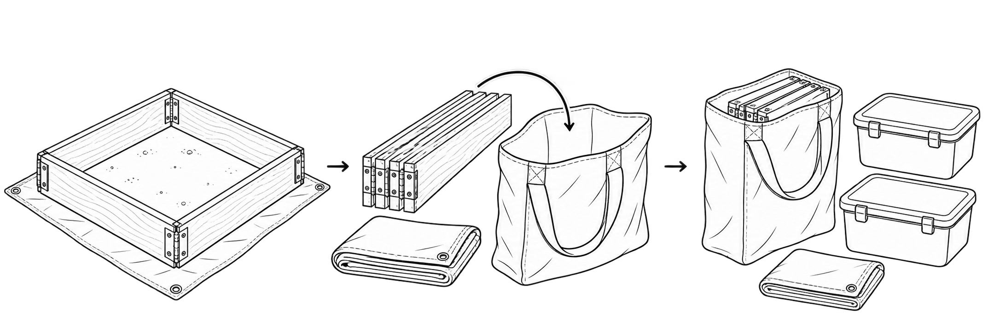
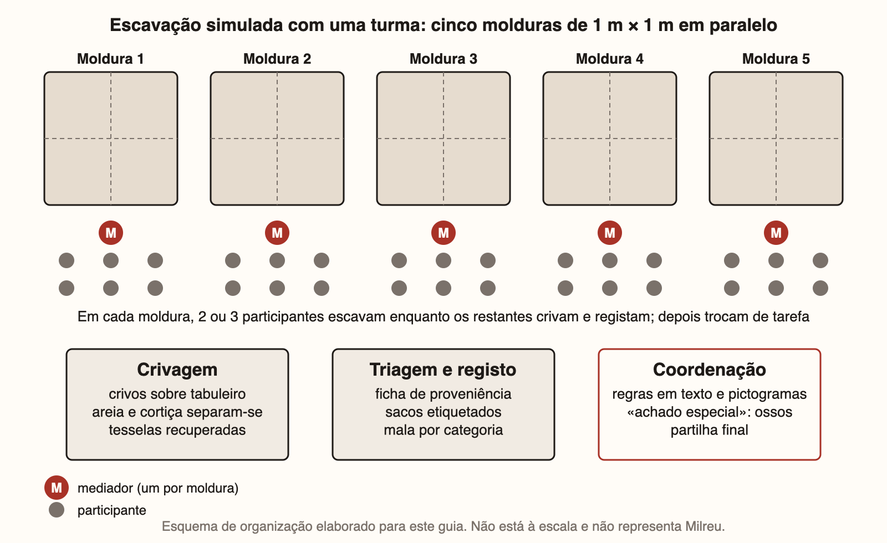

> © 2026 Fernando Rodrigues de Jácomo. Produzido no âmbito do Projecto Comunitário de Milreu. Consultar `RIGHTS.md`.

# Estação 1. Escavação simulada

## 1. A actividade

Na escavação simulada, os participantes escavam uma área delimitada, cheia de um enchimento leve, onde estão enterradas réplicas de objectos arqueológicos, e aprendem que o valor de um achado não está só no objecto: está também no lugar onde foi encontrado, nos objectos que o acompanhavam, na forma como foi descrito e no registo que dele ficou. A descoberta não encerra a actividade, abre-a. Cada réplica encontrada obriga a perguntar o que é, onde estava, com que outras peças apareceu, como se classifica e o que se pode, ou não, concluir a partir dela.

A estrutura de escavação é uma moldura de 1 m × 1 m sem fundo rígido, formada por quatro tábuas laterais com cerca de 1 m de comprimento e 20 cm de altura, articuladas nos cantos por dobradiças metálicas reforçadas, uma por canto. Pelo menos uma das uniões desacopla-se, o que permite dobrar a moldura sobre si mesma. Uns fechos mantêm-na aberta e firme durante o uso. Por baixo estende-se uma lona amovível, com cerca de 1,30 × 1,30 m, que retém o enchimento e protege o chão. Terminada a acção, a moldura guarda-se dobrada, num saco próprio ou dentro da própria lona do fundo, que serve de saco. O projecto prevê cinco molduras, para que uma turma possa trabalhar em paralelo.

O enchimento é uma mistura de areia de gato vegetal biodegradável, com certificação ecológica, e de granulado de cortiça natural. Os dois materiais têm granulometrias diferentes, de modo que se separam na crivagem e podem ser triados no fim da sessão. Ambos são consumíveis: aproveita-se o que estiver em bom estado e repõe-se o resto. A espessura da camada e a proporção entre os dois materiais serão fixadas depois de medida a mistura real, porque é ela que determina o peso. Por decisão do investigador, nenhum volume transportado pode passar de 20 a 30 kg. Com a densidade estimada nos documentos de trabalho, o enchimento de uma moldura com 10 a 15 cm de espessura pesaria entre 35 e 100 kg; reparte-se por isso por dois a cinco contentores por moldura, e usa-se um contentor mais pequeno sempre que um fique pesado demais. A moldura nunca se transporta cheia, porque não tem fundo rígido.

As réplicas são impressas em 3D na impressora do investigador. Os documentos de concepção prevêem fragmentos de cerâmica, objectos com aparência metálica, tesselas, elementos arquitectónicos, ossos simulados e bustos desmontáveis. Para os bustos estão previstos dez conjuntos, oito em uso e dois de reserva, numa distribuição provisória de oito bustos pequenos, com cerca de 20 cm, e dois grandes, com 30 a 40 cm. Cada busto é um conjunto de partes que se encaixam por pinos, e não uma peça única. Os bustos são modelos interpretativos, em alguns casos produzidos com o apoio de ferramentas de inteligência artificial a partir de fotografias, e a etiqueta e o mediador dizem-no. A identificação inicial dos achados é facilitada por uma convenção de cor: cinzento para o que representa metal, tons avermelhados ou castanhos para a cerâmica e branco para o mármore e os bustos. Esta convenção é uma chave da simulação e não uma regra válida para os materiais arqueológicos reais, e, como a cor nunca é o único código no Circuito, cada categoria tem também um símbolo na ficha e na etiqueta da caixa.

O equipamento de cada moldura inclui colherins, pás de mão, espátulas, pincéis macios, um crivo de mão sobre um tabuleiro, baldes leves, uma bandeja de triagem, uma fita métrica, cordel para marcar quadrantes, etiquetas, sacos para os achados, pranchetas com fichas de registo e luvas. As picaretas didácticas só se usam com supervisão e retiram-se da actividade sempre que a idade do grupo o aconselhe; com crianças pequenas usam-se espátulas não perfurantes. Os achados triados seguem para uma mala compartimentada por categoria (bustos, cerâmica, tesselas, metal, ossos).

## 2. Dinâmica geral e objectivos da actividade

O objectivo central da estação é que os participantes reconheçam que um achado arqueológico só tem valor de evidência quando se conhece o seu contexto: a posição em que estava, os objectos que o acompanhavam, a descrição feita no momento e o registo que permite a outra pessoa, mais tarde, reconstituir o que se viu. Para isso a actividade separa duas operações que o público tende a confundir, encontrar e interpretar. Encontrar uma peça é o princípio; dizer que ela é antiga, que pertenceu a alguém ou que prova alguma coisa exige características observáveis e uma hipótese explicada. Um segundo objectivo é mostrar que vestígios diferentes pedem perguntas e especialidades diferentes, e é para isso que existem os ossos simulados.

A sessão começa com uma orientação breve, em que o mediador mostra as regras escritas e com pictogramas, demonstra um gesto (raspar o enchimento em camadas finas com o colherim, em vez de cavar um buraco) e explica o que acontece quando aparece uma peça. Em seguida, cada moldura é dividida em quatro quadrantes com cordel, e os participantes escavam de forma gradual, quadrante a quadrante. Quando uma réplica aparece, segue-se uma pequena sequência que se repete sempre da mesma maneira: observar a posição sem retirar a peça, medir ou indicar em que quadrante está, retirá-la com cuidado, colocá-la num saco com etiqueta e preencher a ficha de registo. O enchimento retirado vai para o crivo, onde se recuperam as peças pequenas, como as tesselas, e onde se percebe que a areia e a cortiça se separam.

Os ossos simulados accionam uma regra própria. Quem os encontra pára a recolha desse elemento, observa-o sem o retirar e chama o «antropólogo», papel que o mediador ou um participante designado desempenha no âmbito da simulação. A regra mostra que certos vestígios exigem observação especializada e tratamento particular. O projecto não promete a presença de um antropólogo profissional em todos os eventos e o mediador deve dizê-lo. Com grupos mais avançados, o achado do osso dá lugar a uma descrição escrita antes de qualquer interpretação e a uma conversa sobre o que falta saber.

Depois da recolha, os achados são classificados, acondicionados e discutidos com as fichas. A sessão termina com uma partilha breve, que é parte da actividade e não um extra: o grupo diz o que encontrou, que hipóteses surgiram, que limitações têm os dados e porque é que o registo é tão importante como o objecto. É neste momento que o mediador verifica se a ideia central passou, perguntando, por exemplo, se seria possível dizer onde estava cada peça sem a ficha.

A dinâmica de grupo depende da idade e do número de pessoas. Numa turma de 25 a 30 alunos, a organização prevista usa as cinco molduras em paralelo, com cinco ou seis participantes por moldura. Em cada uma, dois ou três escavam enquanto os outros crivam e registam, e as tarefas trocam a meio da sessão, para que ninguém fique só a ver. A partir dos 11 anos, os papéis podem tornar-se explícitos e rotativos: escavar, registar e interpretar. A rotação não deve terminar no momento em que aparece o último achado; tem de deixar tempo efectivo de registo, que é onde se aprende o essencial.

A estação liga-se a outras do Circuito. As tesselas recuperadas na crivagem podem seguir para a oficina de mosaicos, onde outro grupo as usa para completar uma composição. Os bustos encontrados podem ser retomados no caderno de actividades. E a escavação com papéis é a base de um dos momentos da componente para adolescentes. Estas ligações são opcionais: a estação funciona sozinha.

Em termos de aprendizagem, a estação procura que os participantes, no fim, consigam fazer pelo menos três coisas: explicar em que lugar estava um achado e porque é que isso importa; distinguir o que observaram do que imaginaram ou inferiram; e reconhecer que uma peça isolada permite poucas conclusões. Estes objectivos são formulações do projecto, a verificar nos testes, e não resultados já observados.

## 3. Proposta por grupos de idade e quantidade de pessoas por actividade

| Grupo | O que se faz | Pergunta-guia | Produto de aprendizagem | Duração indicativa |
|---|---|---|---|---|
| 6–8 | Encontrar réplicas visíveis ou pouco profundas; explorar ferramentas com orientação; agrupar por forma e por material aparente | «O que encontraste? É parecido com que objecto?» | Observação e reconhecimento de vestígios | 15–25 min |
| 9–10 | Escavar por quadrantes e preencher uma ficha ilustrada de proveniência | «Em que quadrante estava?» | Relação entre objecto e contexto | 15–25 min |
| 11–14 | Assumir papéis rotativos de escavação, registo e interpretação | «Que objectos apareceram juntos? O que isso permite supor?» | Classificação e formulação de hipóteses | 20–35 min |
| 15–17 | Comparar associações em contextos propositadamente ambíguos | «Que evidência falta para confirmar a tua hipótese?» | Limites da interpretação arqueológica | 20–35 min |
| Adultos | Registar e discutir cenários alternativos; distinguir o achado da deposição | «Como documentarias este contexto e que inferências evitarias?» | Raciocínio contextual e crítico | 20–40 min |

As durações são estimativas dos documentos de concepção e não medições. O tempo cresce com a profundidade do enchimento, o número de participantes e a necessidade de mediação, e só os testes de abril de 2027 permitirão fixá-lo.

Quanto ao número de pessoas, a referência de trabalho é a seguinte. Cada moldura recebe cinco ou seis participantes ao mesmo tempo, dos quais dois ou três manipulam ferramentas enquanto os restantes crivam e registam. Cada moldura tem um mediador, por decisão do investigador, e a acção tem ainda uma pessoa de coordenação, que pode assumir o papel de «antropólogo». Uma turma de 25 a 30 alunos precisa, assim, das cinco molduras abertas em simultâneo, de cinco mediadores e de um coordenador, o que só é possível se o espaço e a equipa chegarem. Numa acção pontual com um ou dois voluntários abrem-se uma ou duas molduras, e a turma trabalha por rotações sucessivas, com tarefas paralelas para quem espera (o caderno, os quebra-cabeças ou outra estação). Em evento aberto, uma ou duas molduras ou o modelo simplificado com barbantes chegam para participação pontual. Os documentos de concepção apresentam o cenário de 30 alunos com seis participantes por moldura como exemplo de organização, e não como limite de segurança validado.

## 4. Propostas alternativas e adicionais

A estação tem três modelos de uso. O modelo padrão usa a moldura com duas camadas de enchimento, réplicas distribuídas pelas camadas e a lona por baixo, e é o que serve as turmas. O modelo simplificado marca uma quadrícula com barbantes numa só área, eventualmente sobre uma mesa, e serve eventos menores e espaços pequenos; cada sector delimitado pode ser estudado e comparado com os vizinhos. O modelo integrado no solo coloca a moldura sobre terreno natural e permite escavar até 10 cm, para ensinar técnicas como manter o corte aprumado ou decapar por camadas. Este terceiro modelo só se usa onde a intervenção no solo estiver expressamente autorizada e nunca em contexto arqueológico; exige uma zona separada para o material retirado, um plano de reposição do solo e o uso exclusivo de material que possa voltar à terra. A cortiça e os materiais sintéticos não se misturam com a terra a devolver, e as réplicas em plástico são todas recuperadas, porque o filamento não se degrada no solo. A biodegradabilidade e a inocuidade de cada material terão de ser verificadas antes de qualquer acção deste tipo.

Há outras variantes previstas. Uma liga a escavação à oficina de mosaicos: um grupo actua como equipa de descoberta e outro usa as tesselas recuperadas para reconstruir parte de uma composição, de forma colaborativa ou como competição leve, com regras explícitas. Outra é a versão para adolescentes, com papéis definidos (escavar, registar, fotografar, interpretar) e enchimento com mais camadas, descrita no capítulo da componente D. Uma terceira é a montagem das molduras por voluntários, em sessões organizadas, que o cronograma prevê para março de 2027 e que faz da preparação material uma forma de participação.

Os bustos desmontáveis têm também uso próprio, fora da escavação: podem ser apresentados para manipulação e remontagem numa mesa, como demonstração, antes de serem integrados nas molduras. O cronograma prevê testar a sua resistência e a facilidade de montagem em separado, em fevereiro e março de 2027, precisamente para não introduzir na escavação peças que se partam ou que as crianças não consigam remontar.

## 5. Resultados esperados

Os resultados que se seguem são expectativas a verificar no teste de abril de 2027 e nas acções seguintes; nenhum foi ainda observado. Espera-se, no fim de cada sessão, uma pequena colecção de achados simulados com registos interpretáveis e uma explicação, pelo grupo, do raciocínio usado. Espera-se que os participantes consigam indicar a posição de um achado e explicar porque é que ela importa; que distingam o que observaram do que inferiram; e que reconheçam, no caso dos ossos, que há vestígios que pedem outro especialista.

Do lado da organização, o teste deve produzir dados que hoje não existem: o tempo real de uma ronda por idade, incluindo o tempo de registo; o número de participantes activos por moldura que permite a todos fazer alguma coisa com sentido; o peso real do enchimento por moldura e o número de contentores necessário; a resistência das réplicas e dos bustos; e a quantidade de enchimento perdida ou degradada por acção. O teste termina com a classificação da estação como apta para uso pontual, apta com condições ou a necessitar de novo teste.

## 6. Limitações

A primeira limitação é a falta de dados: não há durações medidas, lotação validada nem peso medido do enchimento. A segunda é meteorológica: em exterior descoberto, a chuva altera a área de trabalho, prejudica a observação e pode tornar o exercício impraticável, pelo que a acção prevê suspensão, adiamento ou passagem para uma versão protegida; o calor e a falta de sombra pedem igualmente uma decisão no local. A terceira é de pessoas: o modelo de um mediador por moldura torna a estação exigente em equipa, e com poucos voluntários abre-se menos molduras.

Há limitações materiais. A areia vegetal pode levantar pó durante a crivagem, o que pede verificação do produto concreto e, se necessário, protecção respiratória para quem criva e alternativa sem contacto para quem tenha alergias. As ferramentas partilhadas e as luvas exigem higienização e contagem antes e depois de cada acção. As peças pequenas, como tesselas e pequenas réplicas, são risco de engasgamento para crianças muito pequenas presentes em eventos abertos. O enchimento ocupa vários volumes e exige transporte em carrinha, e a zona onde se monta a estação precisa de protecção do chão e de um sítio para descarregar e voltar a encher os contentores.

Há limitações de conteúdo. A convenção de cores e a ficha de proveniência são criações do projecto, sem precedente validado. O papel do «antropólogo» é uma regra da simulação e não garante a presença de um especialista. Nenhuma das fontes consultadas demonstra que uma caixa de escavação simulada produza aprendizagem, por isso a estação não deve ser apresentada como eficaz antes de avaliada. Por fim, a variante no solo depende de autorização expressa do local e nunca pode ser confundida com autorização para intervir em contexto arqueológico.

## 7. Adaptações para participantes com restrições

A escavação ao nível do chão exige ajoelhar ou agachar e pode ficar inacessível a algumas pessoas. A alternativa é a modalidade reduzida sobre mesa acessível, fornecida pelo local anfitrião e confirmada antes da acção, com uma área de recolha ao alcance e tempo para trabalhar sentado. Quem não queira ou não possa manipular as ferramentas pode participar por indicação verbal: diz onde escavar e o que fazer, e o mediador executa o gesto, sem lhe tirar a decisão.

Para pessoas cegas ou com baixa visão, o mediador descreve oralmente os sectores da moldura e o que se procura, e o registo pode ser feito oralmente. Os cartões de categoria levam símbolo e forma, além de cor e texto. Está previsto testar uma pequena série de réplicas tácteis, com relevos reconhecíveis, sem converter toda a série; até ao teste com utilizadores, essas peças não se anunciam como solução. Para pessoas surdas ou com dificuldade de leitura, as regras, a sequência de registo e o aviso de «achado especial» estão escritos e com pictogramas, e o mediador demonstra cada gesto antes de pedir que o repitam. Para quem tenha sensibilidade ao contacto com o enchimento, ao pó ou ao ruído do crivo, oferece-se uma tarefa sem esse contacto, como o registo ou a triagem dos achados já limpos. As peças maiores são excepção, usadas só quando houver uma necessidade concreta.

## 8. Embasamento teórico

O caso mais próximo do Circuito na bibliografia lida é o ARQUEOLAB, uma actividade apresentada por uma equipa do Porto na Noite Europeia dos Investigadores de 26 de setembro de 2025, dirigida sobretudo aos mais novos. A primeira das suas três actividades era uma «caixa-sondagem» de escavação simulada, com quadrícula, desenho e registo da proveniência dos objectos, e em cada jogo um mediador ajustava a dificuldade e a explicação à idade (Vale et al. 2026, pp. 1863–1865). No fim, os autores recolheram 38 questionários de três perguntas, de pessoas entre os 3 e os 60 anos, e 81,6 % responderam ter aprendido «muito» (pp. 1865–1866). Os próprios autores avisam que foi uma actividade isolada, que o questionário mede uma impressão imediata e não o impacto e que nem todos o devolveram (pp. 1866–1867). O ARQUEOLAB mostra, portanto, que o formato é exequível e bem recebido num evento, mas não demonstra aprendizagem.

O segundo precedente é o projecto educativo *Património Vivo para a Infância*, em Braga, em julho de 2025, com 34 crianças dos 6 aos 10 anos de duas escolas de Vila Verde. As crianças visitaram o Teatro Romano de Braga e participaram em actividades ligadas à escavação e em jogos de procura de moedas romanas (Brito et al. 2026, pp. 1852–1853). O artigo refere essas actividades de passagem, sem as descrever nem as avaliar, porque o seu objecto é o desenho das crianças, tratado no capítulo da componente A; serve aqui apenas para mostrar que crianças desta idade participaram em actividades de escavação num contexto romano.

Fora de Portugal, Henderson e Levstik (2016) acompanharam 74 alunos do 5.º ano nos Estados Unidos numa experiência de interpretação de cultura material e entrevistaram 29 deles três a quatro anos depois, verificando que a experiência arqueológica aprofundada ficou na memória. Recomendam um trabalho por investigação, que parta do que os alunos já sabem, e cuidado com as metáforas usadas com crianças mais novas. O projecto só leu o resumo deste estudo; é o único, na bibliografia consultada, com acompanhamento dos alunos a prazo.

Para a ideia de pôr não-arqueólogos a participar no trabalho em vez de só assistir, a referência do projecto é o *Community Archaeology Project* de Quseir, no Egipto, onde a equipa trabalhou com a população local em colaboração, formação, apresentação pública e produção de recursos educativos (Moser et al. 2002). É um projecto de investigação real e continuado, e não uma oficina de meia hora: serve de inspiração para a divisão de papéis e para a partilha final, por analogia, e não como prova de que uma caixa de escavação funciona.

O conteúdo arqueológico das réplicas tem base nas publicações sobre Milreu. Os bustos de Agripina Menor e de Adriano foram encontrados juntos perto do edifício religioso; o de Galieno foi achado no século XIX; e uma cabeça feminina do início do reinado de Adriano, talvez a dona da casa, está no Museu Nacional de Arqueologia (Hauschild e Teichner 2002, pp. 45–46). Estes dados permitem ao mediador dizer o que os bustos reais são e onde estão, e explicar que as réplicas da moldura são modelos interpretativos.

Na linguagem do parecer crítico adoptado pelo investigador, o conteúdo tem fontes; o procedimento tem precedentes de formato (ARQUEOLAB, Braga), mas nenhum avaliado com instrumento que meça aprendizagem; e a avaliação dispõe apenas do questionário curto do ARQUEOLAB, com os limites que os seus autores reconhecem. O papel do «antropólogo», a convenção de cores e a ficha de proveniência para crianças de 6 a 10 anos não têm fundamentação verificada e são propostas do projecto a testar.

## 9. Bibliografia de referência

As obras citadas neste capítulo constam da bibliografia de referência, no final do guia.

