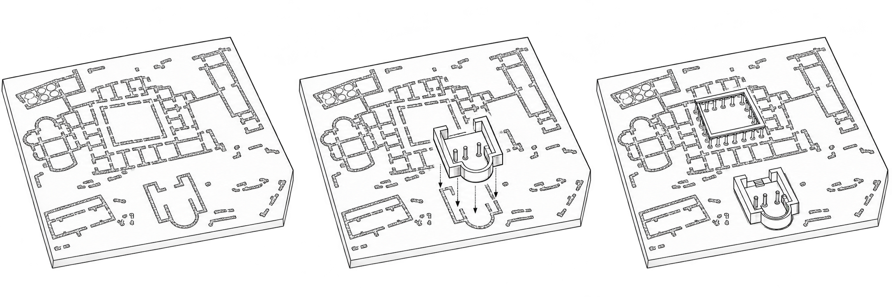

> © 2026 Fernando Rodrigues de Jácomo. Produzido no âmbito do Projecto Comunitário de Milreu. Consultar `RIGHTS.md`.

# Estação 4. Montagem da villa

## 1. A actividade

Na montagem da villa, os participantes reconstroem Milreu sobre uma planta de grandes dimensões. Abrem uma caixa de descobertas, reconhecem os conjuntos de peças que pertencem a cada edifício, montam cada um por encaixe simples e colocam-no no lugar certo da planta. No fim, a planta deixa de ser um desenho abstracto e passa a ser um conjunto de casas, salas, lagares e termas com volume, cada um no seu sítio. A actividade combina três operações: identificar construções, associá-las à planta e reconstruir em colaboração.

A base da estação é uma planta efectiva e documentada de Milreu, e não uma villa romana genérica. A referência é a planta publicada no roteiro do sítio, que numera vinte e dois pontos: a entrada (1), o peristilo (2), o átrio (4), o *triclinium* (10), as termas (11 a 14), um edifício a sul da via (15), construções da zona agrícola a oeste (16 a 18), a casa moderna (19), o santuário (20) e o seu recinto (21 e 22) (Hauschild e Teichner 2002, p. 17, fig. 13). Como a reprodução das figuras do roteiro não está autorizada, a planta da estação será um redesenho próprio do projecto a partir da planta publicada, com a fonte citada na própria planta. A planta tem um exemplar principal e uma cópia de reserva, e o formato final depende da escala dos edifícios.

As estruturas previstas para a caixa de descobertas são seis: a casa rural, o lagar, a parte residencial com o peristilo (*pars urbana*), o edifício de culto, as termas e a parte agrícola (*pars rustica*). A inclusão do centro interpretativo actual é uma possibilidade, para mostrar a relação entre o sítio de hoje e as suas fases passadas, e não uma decisão. O projecto prevê cinco a seis conjuntos desmontáveis, cada um com a sua caixa organizadora etiquetada e o seu inventário de peças, mais um lote comum de elementos de ambientação (vasos, pequenas árvores e outros complementos), guardado à parte. As peças são grandes e encaixam com facilidade, à maneira dos blocos de construção infantis: o desafio é perceber o que se está a reconstruir e onde fica, e não demonstrar destreza com encaixes difíceis.

Cada edifício terá uma cor que identifica a sua função e o período a que pertence, acompanhada sempre de um segundo código (um número, uma letra ou um símbolo), porque a cor nunca é o único código no Circuito. Esta correspondência entre edifício, função, cor e período será fixada durante a preparação, em maio de 2027, a partir das fontes. A estação é testada em junho de 2027. Sem financiamento, tem duração própria, fora da regra dos dois meses por acção.

Na produção dos edifícios, o projecto segue a regra que a sua metodologia de reconstrução digital estabelece para as estruturas: primeiro uma planta controlada, depois uma massa arquitectónica simples, e só no fim os pormenores e a ornamentação. Esta ordem permite saber, se houver um erro, se ele vem da fonte histórica, do levantamento ou de uma escolha visual, e torna mais fácil explicar ao público que partes de cada edifício estão documentadas e que partes são hipótese.

## 2. Dinâmica geral e objectivos da actividade

O objectivo da estação é que os participantes compreendam a organização espacial de Milreu e as suas transformações, reconhecendo a função e a localização relativa das diferentes áreas, e que percebam a diferença entre o que está documentado sobre o sítio e o que é reconstrução. Este segundo ponto é tão importante como o primeiro: uma maqueta bonita convence facilmente de que a villa era exactamente assim, e o mediador tem de desfazer essa ilusão sem tirar o prazer da construção.

A sessão segue seis passos, tal como estão descritos nos documentos de concepção. Primeiro, o grupo recebe a planta e o mediador situa-a: onde é a entrada, por onde passava a via, o que é o peristilo. Segundo, os participantes exploram a caixa de descobertas e identificam os conjuntos de peças que pertencem a cada edifício. Terceiro, reúnem as peças de cada construção. Quarto, montam-nas. Quinto, colocam cada construção no lugar correspondente da planta. Sexto, se houver tempo, decoram a villa com árvores, vasos e outros elementos livres. Esta última fase é expressão criativa, e o mediador diz claramente que as escolhas decorativas não são factos arqueológicos.

Com muitos participantes, cada subgrupo fica responsável por uma ou mais estruturas, monta-as à parte e traz o resultado para a planta comum. A reconstrução torna-se colectiva: cada equipa contribui para a planta geral, observa o trabalho das outras e participa numa explicação final do conjunto. O trabalho cooperativo evita que cada pessoa tenha de montar a villa inteira e mostra, ao mesmo tempo, que o sítio se compreende pela integração das partes.

O mediador usa a montagem para contar Milreu com dados. A villa seguia a divisão que o agrónomo Columela descreveu no século I, entre a parte residencial do dono, a parte agrícola e a zona de armazenagem (Hauschild e Teichner 2002, p. 14). A casa organizava-se em torno de um grande peristilo com jardim e tanque central, com oito colunas no lado maior e seis no menor (p. 20). As termas ocupavam um conjunto de cerca de 32 × 31 m, com sala de entrada, vestiário, sala fria, sala tépida e sala quente com banheira semicircular (pp. 28–31). O lagar de azeite tinha cinco prensas e uma cave para dezenas de grandes talhas e é considerado o maior lagar de azeite conhecido da Lusitânia (Teichner e Peña Cervantes 2010/2011, pp. 450–451, 454). O edifício de culto, construído no século IV sobre um pódio, foi transformado em igreja no século V e recebeu um baptistério no século VI (Hauschild e Teichner 2002, pp. 49–55). A casa rural fortificada, com quatro torres de canto, é muito posterior e foi habitada até meados do século XX (pp. 12, 59).

Esta última informação leva ao segundo grande objectivo: a villa não teve uma configuração fixa do século I ao século V, e muito menos até ao século XX. Os edifícios da planta actual não coexistiram todos da mesma maneira, e a montagem deve evitar essa impressão. O código de cor por período e, nos grupos mais velhos, a introdução de mudanças de fase servem para isso. As fases de ocupação definidas por Teichner são conhecidas pelo projecto apenas por uma síntese (Wielewski 2022, pp. 34–36), e o mediador apresenta-as como proposta dos investigadores. Há ainda pontos em que os especialistas não concordam, e que são bons temas para os grupos a partir dos 15 anos: o edifício de culto tem pelo menos quatro leituras diferentes, como santuário das águas, como *nymphaeum* ou mausoléu, como sala de representação do dono e como mausoléu (Hauschild e Teichner 2002, pp. 52, 55; Teichner 2001, p. 190; Hauschild 2008).

Os objectivos de aprendizagem propostos são: reconhecer pelo menos três edifícios e a sua função; colocá-los na planta com coerência; e explicar, a partir dos 11 anos, uma diferença entre o que está documentado, o que é inferido e o que foi criado na decoração. São objectivos a verificar no teste de junho de 2027.

## 3. Proposta por grupos de idade e quantidade de pessoas por actividade

| Grupo | O que se faz | Objectivo | Duração indicativa |
|---|---|---|---|
| 6–8 | Encaixar poucas estruturas com imagens de apoio | Reconhecer edifícios e diferenças entre eles | 20–30 min |
| 9–10 | Associar edifícios a funções | Distinguir residência, banhos, produção e culto | 20–30 min |
| 11–14 | Localizar as peças na caixa de descobertas e montar conjuntos | Interpretar a planta e o espaço | 25–40 min |
| 15–17 | Introduzir mudanças de fase e estruturas sucessivas | Evitar uma visão intemporal da villa | 30–40 min |
| Adultos | Debater evidência, analogia e liberdade artística | Entender os limites da reconstrução | 30–40 min |

O documento de adaptações indica 20 a 40 minutos para a estação; a repartição por grupo é uma proposta deste guia dentro desse intervalo. A montagem, a colocação na planta e a síntese final devem ter tempos separados na programação, para que a explicação final não seja sacrificada.

A capacidade total não está fixada e depende do espaço em torno da planta. Com cinco ou seis conjuntos, a hipótese de trabalho é de cinco ou seis subgrupos de cinco ou seis pessoas, o que corresponde a uma turma de 25 a 36 alunos numa só ronda, desde que a superfície permita circular à volta da planta. Estima-se que um mediador acompanhe a montagem e outro conduza a colocação e a síntese; com um só mediador, a turma pode trabalhar em duas metades sucessivas. Em evento aberto, a estação funciona como montagem progressiva: cada pessoa ou família monta um edifício e coloca-o na planta, que se vai completando ao longo do dia.

## 4. Propostas alternativas e adicionais

A versão por sectores divide a planta em partes que se montam em mesas separadas, para espaços pequenos ou para quem tem alcance limitado. A inclusão do centro interpretativo actual permite comparar a Milreu de hoje com a das fases antigas e falar de quem gere e visita o sítio. Para os grupos mais velhos, a montagem pode fazer-se em duas ou três passagens, uma por fase, retirando e acrescentando edifícios, de modo a mostrar que a villa mudou.

A estação liga-se ao jogo de construção da villa, na oficina digital, que trata os mesmos edifícios do ponto de vista da economia e do tempo; ao caderno de actividades, que tem páginas sobre a villa e os seus edifícios; e aos quebra-cabeças da componente C, um dos quais terá como tema a planta de Milreu. Antes ou depois de uma visita às ruínas, a montagem ajuda a orientar o percurso, e a caça ao tesouro pode partir de elementos dos edifícios montados.

Outra proposta, útil para mostrar como o conhecimento muda, é contar a história das plantas de Milreu: Estácio da Veiga escavou e desenhou a primeira em 1876 e 1877, seguiram-se outras em 1898 e em 1950, e Felix Teichner reinterpretou uma área do sítio, a área 21, a partir da planta de Estácio da Veiga (Teichner 2001). Uma planta não é um retrato fixo do sítio, mas o resultado de várias campanhas e leituras.

## 5. Resultados esperados

Espera-se, em cada sessão, uma representação colectiva da villa sobre a planta, com as estruturas identificadas e uma explicação, pelo grupo, das relações entre função, espaço e tempo. Espera-se que os participantes consigam localizar os sectores de forma coerente e, a partir dos 11 anos, distinguir uma construção antiga de um elemento contemporâneo. Estes resultados são expectativas a verificar no teste de junho de 2027, que deve ainda registar as dificuldades com a escala da planta, a distribuição de tarefas pelos subgrupos, a resistência dos encaixes e o tempo de cada fase. A estação será classificada como apta para uso pontual, apta com condições ou a necessitar de novo teste.

## 6. Limitações

A estação precisa de uma superfície ampla, interior ou coberta, com circulação à volta, e não deve decorrer em exterior descoberto com chuva ou vento. A lista final de estruturas, a escala, o desenho dos módulos e a correspondência entre cores, funções e períodos ainda não estão fechados. O consumo de filamento por edifício só será conhecido depois de desenhados e fatiados os modelos, e o projecto não fixa quantidades antes disso.

Há limitações de conteúdo que pesam mais do que as materiais. As alturas, coberturas e decorações dos edifícios são, em grande parte, hipóteses; na escala de evidência do projecto, o contorno dos edifícios apoia-se na planta (E2), as volumetrias são hipóteses interpretativas (E3) e as árvores e vasos são criação lúdica (E4), e a maqueta deve dizer que contém elementos hipotéticos. As fases de Teichner só são conhecidas em segunda mão. A planta do roteiro não pode ser reproduzida sem autorização, o que obriga a um redesenho próprio com citação. Por fim, peças decorativas pequenas e eventuais ímanes só se usam se forem adequados às idades presentes.

## 7. Adaptações para participantes com restrições

A planta é essencialmente visual e ocupa uma área grande, o que cria duas barreiras: para pessoas cegas ou com baixa visão e para quem não alcança zonas afastadas. Para a primeira, o projecto prevê testar texturas e encaixes tácteis em alguns edifícios prioritários, sem relevo da planta inteira, e o mediador indica oralmente a localização de cada sector; uma planta táctil integral e fiel exigiria desenvolvimento próprio. Para a segunda, a versão por sectores, montada por partes numa mesa acessível fornecida pelo anfitrião, põe tudo ao alcance.

As fases e funções distinguem-se por cor e por um segundo código, o que serve pessoas com daltonismo. Para dificuldades de motricidade fina, as peças são grandes e os encaixes simples, e a pessoa pode decidir e pedir ao mediador ou a um colega que execute. As instruções e os nomes dos edifícios estão escritos e com pictogramas, para pessoas surdas e para quem tem dificuldade de leitura. Conjuntos ampliados só se fazem pontualmente.

## 8. Embasamento teórico

O conteúdo da estação é o mais bem documentado do Circuito. A planta de referência, com os seus vinte e dois pontos, está publicada no roteiro do sítio (Hauschild e Teichner 2002, p. 17, fig. 13), que descreve também o peristilo, o átrio, as salas, o *triclinium*, as termas, os lagares, os mausoléus e o edifício de culto, com medidas e datações (pp. 14–59). A produção de azeite e de vinho, a dimensão do lagar e as fases da exploração agrícola estão estudadas por Teichner e Peña Cervantes (2010/2011, pp. 449–454). Bernardes (2006) propôs novas interpretações do peristilo, depois de reescavada parte da sua ala sul; o projecto conhece este artigo pelo resumo. Teichner (2001) mostra, com a área 21, como a leitura de uma parte do sítio mudou com a revisão das plantas antigas, um exemplo directo de que uma planta é uma interpretação.

O procedimento, pelo contrário, não tem precedente avaliado na bibliografia lida. O parecer crítico adoptado pelo investigador não encontrou nenhuma demonstração de uma maqueta modular educativa comparável, e a estação é, nesse aspecto, uma proposta própria a testar. O trabalho em subgrupos tem um enquadramento geral na sociologia da infância: Corsaro (2015), na introdução e no glossário da sua obra, descreve as crianças como agentes que produzem culturas de pares e que se apropriam de forma criativa da informação do mundo adulto, a que chama reprodução interpretativa. Esta ideia justifica desenhar tarefas em que as crianças negoceiam entre si a solução, em vez de apenas responderem ao adulto, mas não é um estudo sobre maquetas nem sobre património, e não demonstra o efeito da estação.

A avaliação também não tem fundamentação verificada. Os critérios de observação usados no teste (localizar com coerência, explicar uma função, distinguir o documentado do criado) são propostas internas do projecto e não instrumentos validados.

## 9. Bibliografia de referência

As obras citadas neste capítulo constam da bibliografia de referência, no final do guia.

