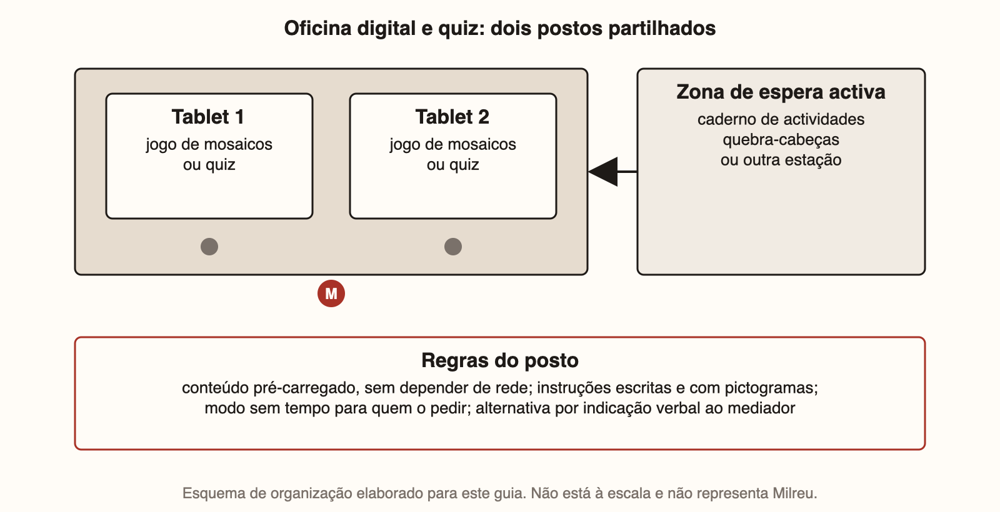

> © 2026 Fernando Rodrigues de Jácomo. Produzido no âmbito do Projecto Comunitário de Milreu. Consultar `RIGHTS.md`.

# Estação 6. Oficina digital: jogo de mosaicos

## 1. A actividade

A oficina digital oferece uma experiência curta em tablet ou computador: um jogo de mosaicos que retoma no ecrã o tema da estação 2. O jogo não substitui a mediação histórica nem a oficina física. Serve para explorar as regras de composição de um mosaico através de decisões e de respostas imediatas do próprio jogo, num formato que muitos participantes conhecem e que pode funcionar em espaço interior, inclusive em dia de chuva.

Os documentos de concepção previam nesta estação um segundo jogo, um minijogo de construção da villa. Por decisão do investigador de 21 de novembro de 2026, esse jogo saiu do escopo actual do Circuito, juntamente com as estações 5 e 7, porque as actividades previstas eram demasiadas para uma só pessoa preparar e conduzir. A estação conserva o número 6 e passa a ter apenas o jogo de mosaicos, o que simplifica o posto, a preparação dos mediadores e o desenvolvimento do software.

No jogo, o jogador vê um mosaico parcialmente preenchido e, de cada vez, surge no ecrã uma tessela escolhida ao acaso. Antes de a colocar, pode observá-la numa zona de análise, rodá-la e compará-la com o padrão, e só depois decide onde a encaixar. O objectivo é completar o motivo, combinando reconhecimento visual, antecipação e precisão. Há três graus de dificuldade: no fácil, a composição está quase completa e restam poucas lacunas; no médio, cerca de metade já está montada; no difícil, só algumas peças iniciais estão colocadas e quase todo o padrão tem de ser reconstruído. O jogo terá dois modos, um de descoberta, sem pressão de tempo, e outro de desafio, com tempo e pontuação. Os documentos de concepção prevêem também uma disponibilização posterior em telemóveis, que não faz parte deste guia.

Os motivos a completar partem do repertório que a estação 2 já usa e que as publicações sobre Milreu descrevem com página. O roteiro do sítio data do século II os motivos mais antigos, as linhas negras em meandro da área do peristilo, descreve os mosaicos geométricos do século III, com peltas, rácimos e xadrez colorido, e atribui os mosaicos de fauna marinha de meados do século IV a uma oficina itinerante (Hauschild e Teichner 2002, pp. 20–22, 43–44). Como na oficina física, nenhuma composição do jogo se apresenta como reprodução de um pavimento de Milreu sem o ser. Um motivo inspirado no repertório do sítio é identificado como inspirado, e uma composição que preencha as lacunas de um pavimento fragmentário é apresentada como reconstituição, segundo a regra comum do Circuito que separa o documentado, o interpretado e o inventado. A escolha final dos motivos e a forma de os identificar no ecrã fazem parte do desenvolvimento do jogo e ainda não estão fixadas.

O jogo será desenvolvido pelo investigador. Em 21 de novembro de 2026 nenhum código estava produzido: a estação é preparada em julho de 2027, com uma versão demonstrável num dispositivo de teste, e testada em agosto. O equipamento previsto são dois tablets, no mínimo, a adquirir, partilhados com o quiz da estação 9. Os conteúdos ficam pré-carregados nos dispositivos, para que a estação não dependa de rede. Sem financiamento, o jogo só corre onde o local anfitrião tiver computador.

Os dois tablets servem o jogo de mosaicos e o quiz, o que obriga a organizar a estação como um posto partilhado e não como dois postos independentes. Os dispositivos ficam numa mesa estável, em local abrigado e com energia ou autonomia suficiente, e são verificados antes de cada acção: carga, legibilidade do ecrã à luz do local, funcionamento do jogo sem rede e presença dos pictogramas nas instruções. As licenças de software usadas pelo investigador na produção do jogo ficam fora de qualquer pedido de financiamento, porque são absorvidas por ele. Se o jogo falhar durante a acção, o mediador passa ao quiz, e se nenhum funcionar a estação fecha e o grupo segue para outra, de preferência a oficina de mosaicos física.

## 2. Dinâmica geral e objectivos da actividade

O jogo de mosaicos tem um objectivo específico: reconhecer padrões e escolher a tessela certa para cada lugar, aplicando no ecrã as regras de composição que a oficina de mosaicos trabalha com as mãos. A tessela que aparece ao acaso obriga o jogador a olhar para a forma, a cor e a orientação antes de decidir, e a zona de análise dá-lhe tempo para isso. O erro deve gerar informação compreensível, explicando porque é que aquela peça não serve ali, e não encerrar a aprendizagem: um jogador que falha deve perceber o que olhar a seguir. O modo de descoberta, sem tempo, é o recomendado para as crianças mais novas e para quem o pedir; o modo de desafio, com tempo e pontos, é opcional.

A relação com a estação 2 é deliberada. Na oficina física, o número de composições está limitado pelos conjuntos que existem, e cada tessela tem de ser procurada, colocada e, no fim, contada e arrumada. No ecrã, o jogador pode experimentar uma posição, perceber de imediato se a peça encaixa no padrão e voltar a tentar, o que torna visível a regra de composição sem o peso do material. As duas estações completam-se: a oficina física dá o gesto e a escala das peças, e o jogo dá a repetição rápida da decisão. O mediador pode propor que o mesmo motivo seja reconhecido nas duas, ou que o jogador complete no ecrã uma composição que já viu em papel no caderno de actividades.

O jogo também serve para falar da diferença entre o mosaico tal como está e a sua reconstituição. Os autores do roteiro lembram que a decoração musiva de Milreu está hoje fragmentária e em parte coberta por uma camada de areia protectora, e que só com a imaginação se recria o antigo colorido dos pavimentos (Hauschild e Teichner 2002, p. 20). Completar um mosaico no ecrã é, num certo sentido, fazer essa reconstituição, e o mediador deve dizê-lo: a parte que o jogo dá já colocada e a parte que o jogador completa não têm o mesmo estatuto quando o motivo vem de um pavimento real. O jogo simplifica também a técnica. No friso marinho de Milreu, as linhas de contorno foram feitas com tesselas de 1 a 2 mm, que os autores comparam ao traço de um pincel (p. 22), muito menores do que as peças de um jogo pensado para ser legível num tablet, e essa diferença é um bom ponto de conversa com os grupos mais velhos.

A dinâmica da estação é simples. Um jogador por dispositivo, ou um par que joga em conjunto e discute as decisões, uma partida de cinco a dez minutos e uma pergunta do mediador no fim. A pergunta pode ser «que regra te ajudou a encontrar o sítio da peça?» ou, quando o motivo vem de Milreu, «que parte deste mosaico se conhece e que parte foi completada?». A conversa curta transforma a partida numa actividade de aprendizagem e permite ao mediador verificar se a relação entre o jogo e os mosaicos de Milreu ficou clara. Com dois tablets, a turma passa pela estação em rotação, e a zona de espera tem de ter uma tarefa: o caderno, os quebra-cabeças ou outra estação.

Os objectivos propostos para a estação são três: completar uma composição no nível escolhido reconhecendo o padrão; explicar a regra usada para colocar as peças; e distinguir, quando o motivo vem de Milreu, o que está documentado do que foi completado no jogo. Serão verificados no teste de agosto de 2027, que deve também avaliar se a experiência mantém conteúdo educativo e não depende só de recompensas e rapidez, uma vez que um jogo com pontos e tempo pode deslocar a atenção da regra de composição para a velocidade de resposta.

## 3. Proposta por grupos de idade e quantidade de pessoas por actividade

| Grupo | Jogo de mosaicos | Duração por partida |
|---|---|---|
| 6–8 | Nível fácil, poucas peças, encaixe muito claro, sem limite de tempo obrigatório | 5–10 min |
| 9–10 | Fácil ou médio; padrões de continuidade e orientação | 5–10 min |
| 11–14 | Médio; análise de peças e padrões menos completos | 5–10 min |
| 15–17 | Médio ou difícil; simetria, regularidade e inferência visual; distinção entre documentado e completado | 5–10 min |
| Adultos | Escolha da dificuldade; leitura formal e interpretações opcionais | 5–10 min |

A duração de cinco a dez minutos por partida vem dos documentos de concepção e é uma estimativa. Sessões mais longas só se fazem quando o evento o comportar.

Cada dispositivo serve um jogador de cada vez, ou um par que joga em conjunto. Com dois tablets e partidas de cinco a dez minutos, uma turma de 25 a 30 alunos precisaria de mais de uma hora para passar toda pela estação, pelo que numa turma a oficina digital funciona como estação de rotação dentro do circuito, e não como actividade para todos ao mesmo tempo. Basta um mediador para os dois postos e para o quiz. Em evento aberto, a estação funciona por ordem de chegada, com a zona de espera organizada.

## 4. Propostas alternativas e adicionais

Quando não houver tablets, a estação pode funcionar num computador do local anfitrião, desde que tenha o jogo instalado e testado. Quando não houver nenhum dispositivo, a oficina de mosaicos física cobre o mesmo tema, e a estação não se realiza.

A estação liga-se directamente à estação 2, porque o mesmo motivo pode ser reconhecido no mosaico físico e no jogo, e às páginas de mosaicos do caderno de actividades. Uma sequência possível, numa sessão com tempo, é completar um mosaico em papel no caderno ou com tesselas na oficina e depois no ecrã, ou o inverso, e comparar no fim as duas experiências.

Para grupos de 15 anos ou mais, o próprio jogo pode ser objecto de discussão: que simplificações faz, o que um mosaico no ecrã não mostra sobre o trabalho de quem o executou, e porque é que uma reconstituição completa nunca tem o mesmo estatuto do pavimento conservado. Esta conversa transforma uma limitação do jogo num conteúdo.

## 5. Resultados esperados

Espera-se que a maioria dos jogadores complete pelo menos uma composição no nível escolhido e consiga dizer que regra usou, e que os grupos mais velhos distingam, num motivo de Milreu, a parte documentada da parte completada. Estes resultados são expectativas a verificar no teste de agosto de 2027, que deve medir também a compreensão das instruções sem ajuda, a duração real das partidas, a progressão de dificuldade, o interesse e a possibilidade de participação com apoio. Até haver teste, o software não é classificado como testado.

## 6. Limitações

A estação depende de software que ainda não existe, de dispositivos que ainda não foram adquiridos e de um posto em local protegido, com energia. Estão por decidir os tempos-limite, o sistema de pontuação, o tratamento de erros, a forma de acumular peças na zona de análise e os motivos a usar. Com dois tablets, a capacidade da estação é baixa para turmas inteiras. A compatibilidade com telemóveis não está garantida e não faz parte do âmbito actual. Se o jogo estiver instável no dia de uma acção, a estação é substituída por outra ou por uma demonstração não competitiva.

Há também limitações de conteúdo. A revisão da bibliografia não encontrou estudos que validem as mecânicas escolhidas: o tempo, os pontos e os três níveis são decisões de concepção, e não resultados científicos. O jogo tende a recompensar a rapidez, o que pode deixar para trás quem lê ou joga a outro ritmo.

## 7. Adaptações para participantes com restrições

As instruções do jogo não podem depender de áudio: aparecem em texto e acompanhadas de pictogramas, com contraste suficiente e, quando tecnicamente possível, letra ampliável. O modo sem tempo existe para quem precise de outro ritmo, por dificuldade de leitura, de atenção ou de motricidade, e o temporizador pode ser suspenso. Quem não consiga arrastar peças no ecrã pode indicar a jogada ao mediador, que a executa; a decisão continua a ser do participante.

O projecto controla o excesso de estímulos e as animações rápidas, porque há risco para pessoas com epilepsia fotossensível, e por isso o jogo limita clarões e permite reduzir as animações. A cor não pode ser o único critério para escolher o lugar de uma tessela: a forma e a orientação das peças contam também, de acordo com a regra comum do Circuito. A acessibilidade digital, incluindo o uso com teclado e leitores de ecrã, não se presume antes de testada. Para pessoas cegas, um jogo de base visual não tem, por agora, equivalente acessível, e a oficina de mosaicos física, com as peças tácteis do piloto quando existirem, é a alternativa.

## 8. Embasamento teórico

O conteúdo do jogo é o da estação 2, com as fontes aí indicadas: o roteiro do sítio para a cronologia e os motivos dos mosaicos de Milreu (Hauschild e Teichner 2002, pp. 20–22, 43–44) e Bernardes (2011, p. 21) para os temas marinhos, onde estão representados moluscos e peixes dos mares do Algarve.

Para o procedimento e a avaliação, a bibliografia disponível é de revisões gerais sobre jogos sérios, todas conhecidas pelo projecto pelo resumo e nenhuma sobre Milreu ou sobre crianças portuguesas. Mortara et al. (2014) traçam um panorama dos jogos sérios no património cultural e relacionam o tipo de jogo, o contexto de uso e a tecnologia com a eficácia de aprendizagem. Malegiannaki e Daradoumis (2017) reviram 34 jogos que promovem a interacção com um lugar cultural e os seus objectos e descrevem que resultados costumam ser medidos. Ćosović e Brkić (2020) discutem os prós e os contras da aprendizagem por jogo em museus. Boyle et al. (2016), numa revisão sistemática de 143 estudos publicados entre 2009 e 2014, concluíram que o resultado mais frequente dos jogos para aprendizagem é a aquisição de conhecimento e pedem estudos que mostrem que características do jogo produzem envolvimento e aprendizagem. Bellotti et al. (2013) notam que a eficácia dos jogos sérios continua pouco estudada e que muitos trabalhos não têm avaliação rigorosa, e discutem o papel do retorno dado ao jogador.

Estas obras servem para situar a estação num campo de investigação e para lembrar como deve ser avaliada, mas nenhuma valida as mecânicas concretas do jogo de mosaicos. O parecer crítico adoptado pelo investigador declara a lacuna: duração, progressão, recompensas e atenção são decisões de concepção, e a aprendizagem terá de ser verificada com observação, testes de usabilidade e, se possível, comparação antes e depois. As obras de arqueologia pública que o projecto usa para fundamentar a participação também não validam mecânicas de jogo.

## 9. Bibliografia de referência

As obras citadas neste capítulo constam da bibliografia de referência, no final do guia.
