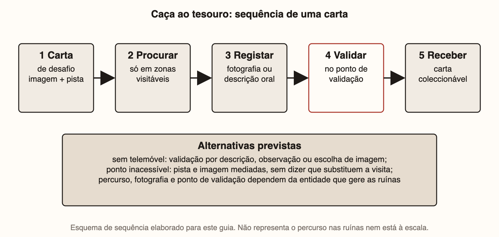

> © 2026 Fernando Rodrigues de Jácomo. Produzido no âmbito do Projecto Comunitário de Milreu. Consultar `RIGHTS.md`.

# Estação 7. Caça ao tesouro nas ruínas

## 1. A actividade

A caça ao tesouro transforma a visita às Ruínas Romanas de Milreu numa observação activa do sítio. Cada participante recebe uma carta de desafio com a identificação ou uma pista de um elemento das ruínas, por exemplo um pormenor de mosaico ou de coluna, percorre as zonas visitáveis para o encontrar, fotografa-o e apresenta a fotografia num ponto de validação. Confirmada a correspondência, recebe uma carta coleccionável sobre aquele elemento, com informação patrimonial que pode levar consigo. A recompensa reforça a memória da visita, mas não substitui a aprendizagem: o centro da actividade é olhar com atenção para um vestígio real e saber o que ele é.

Ao contrário das outras estações, esta não é portátil. Só faz sentido dentro das ruínas, depende de um projecto interno próprio e da articulação com a entidade que gere o sítio, e não passa automaticamente a ser uma actividade itinerante. Para funcionar, precisa de três autorizações da entidade gestora: o percurso, que só pode usar zonas visitáveis; as regras de fotografia; e o local e as condições do ponto de validação. Até essas autorizações existirem, a estação mantém-se em concepção. A equipa das Ruínas Romanas de Milreu, do Património Cultural, I.P., é a principal parte interessada nesta estação e no Circuito em geral: o projecto informá-la-á e convidá-la-á a participar nas decisões sobre o percurso, as cartas e o ponto de validação, e propõe-se, a acordar, que possa ajudar na mediação e disponibilizar espaço no sítio, por exemplo para o ponto de validação ou para a versão por imagem em dia de mau tempo.

O material previsto são cerca de dez a quinze cartas de desafio diferentes e as respectivas cartas coleccionáveis, inspiradas na experiência das cartas coleccionáveis dos videojogos; versões das cartas em texto e com pictogramas; fichas de validação; e um balcão ou mesa de apoio no ponto de validação, com cadeira para o mediador. O número de exemplares de cada carta depende do público e não deve ser confundido com o número de modelos. Ainda não está definido se a colecção completa se obtém numa visita, em várias visitas ou em eventos sucessivos, nem quantas cartas cada pessoa deve procurar.

Os elementos a escolher para as cartas sairão do que é visitável e do que está documentado com fonte. O roteiro do sítio descreve vários candidatos com interesse para uma busca visual: a entrada com os dois tanques semicirculares, que outrora tinham cúpula (Hauschild e Teichner 2002, p. 19); as colunas do peristilo, oito no lado maior e seis no menor (p. 20); o friso de seres marinhos e as escamas imbricadas dos mosaicos do peristilo (pp. 20–22); os peixes nos degraus da sala fria das termas (pp. 43–44); as prensas e a cave do lagar de azeite (pp. 33–34); o pódio do edifício de culto (pp. 49–55); e a casa rural fortificada, com as suas torres de canto, muito posterior à villa (pp. 12, 59). A lista final será escolhida com a entidade gestora, tendo em conta a conservação de cada vestígio e a acessibilidade do percurso.

A preparação das cartas, dos desafios e da proposta de validação está prevista para agosto de 2027 e o teste para setembro, sempre condicionados à autorização do sítio. Nos dois cenários de financiamento, a caça ao tesouro entra: o que a condiciona é a autorização, não o dinheiro. Se a autorização não existir em outubro de 2027, a estação não se apresenta como realizável no sítio.

## 2. Dinâmica geral e objectivos da actividade

O objectivo educativo da caça ao tesouro é identificar e observar elementos reais de Milreu, associá-los ao lugar e reconhecer a informação histórica sobre cada um. É a única actividade do Circuito em que o participante está diante dos vestígios originais, e o mediador aproveita isso para ligar o que se aprendeu nas outras estações ao que se vê: o peristilo que se montou sobre a planta está ali, com as suas colunas; os peixes que se completaram em tesselas estão ali, num degrau das termas; o lagar do jogo de construção está ali, com os sítios das prensas.

A dinâmica tem cinco passos. O participante recebe uma carta de desafio, com uma imagem e uma pista, cuja dificuldade depende do nível escolhido. Percorre as zonas visitáveis autorizadas à procura do elemento, acompanhado quando a idade o exige. Quando o encontra, fotografa-o, respeitando as regras do sítio e sem tocar nos vestígios; quem não tem telemóvel ou não quer fotografar pode registar a descoberta de outra forma, descrevendo-a oralmente, desenhando-a ou escolhendo-a entre várias imagens no ponto de validação. No ponto de validação, o mediador confirma a correspondência e faz uma pergunta curta sobre o elemento. Por fim, entrega a carta coleccionável, que diz o que é o elemento, de que época é e qual a fonte da informação.

As cartas coleccionáveis são um instrumento de conteúdo e devem ser escritas com o mesmo rigor das fichas das estações. Cada carta distingue o que está documentado do que é hipótese, e cita a fonte. A caça ao tesouro é também uma boa ocasião para tratar um dos problemas que estão na origem do Circuito, o da informação errada que circula sobre Milreu: uma carta pode, por exemplo, contar que durante séculos se julgou que Milreu era a cidade de Ossonoba, ideia que remonta a André de Resende, em 1570, e que só foi afastada de vez quando Abel Viana demonstrou, em 1952, que Ossonoba está sob Faro (Hauschild e Teichner 2002, p. 10).

A organização das cartas e do percurso tem uma regra de conservação que prevalece sobre o jogo: não se concentram grupos em torno de um vestígio frágil apenas para acelerar a colecção. As cartas distribuem as pessoas por pontos diferentes, e o ponto de validação fica num local que não crie aglomeração. A recompensa não premeia a rapidez nem penaliza quem fica para trás; o mediador valoriza a observação e a explicação.

Os objectivos de aprendizagem propostos são: localizar um elemento a partir de uma pista; descrevê-lo com as próprias palavras; e, a partir dos 11 anos, associá-lo a um período e a uma função. Serão verificados no teste de setembro de 2027, se ele se puder realizar nas ruínas.

O ponto de validação é também um lugar de mediação, e não só de controlo. O mediador adapta a pergunta curta ao nível escolhido: a uma criança de 6 a 8 anos pergunta o que é o elemento que encontrou; a um participante de 11 a 14 anos, para que servia; a um adulto, como se sabe isso. A carta coleccionável que recebe fica com o participante e leva para casa a informação e a fonte, o que permite à família retomar a conversa depois da visita.

## 3. Proposta por grupos de idade e quantidade de pessoas por actividade

| Grupo | O que se faz | Duração indicativa |
|---|---|---|
| 6–8 | Reconhecer imagens e localizar elementos evidentes, sempre acompanhados | 20–30 min |
| 9–10 | Procurar pormenores e responder a uma pergunta simples | 20–35 min |
| 11–14 | Interpretar pistas visuais e arquitectónicas | 25–45 min |
| 15–17 | Associar a identificação à contextualização histórica | 25–45 min |
| Adultos | Comparar vestígios, documentação e hipóteses de interpretação | 25–45 min |

O documento de adaptações indica 20 a 45 minutos, conforme o percurso e o número de cartas; a repartição por grupo é uma proposta deste guia. A duração real depende do número de desafios, do percurso permitido e da concentração de participantes.

Não há número máximo definido. A capacidade depende da circulação admissível no sítio, da distribuição das pessoas pelos pontos de observação e da rapidez do ponto de validação, e terá de ser fixada com a entidade gestora. Estima-se um mediador no ponto de validação e, pelo menos, um acompanhante por pequeno grupo de crianças dos 6 aos 8 anos; com turmas, os professores acompanham os grupos no percurso. Uma turma de 25 a 30 alunos pode ser dividida em grupos de cinco ou seis, cada um com um conjunto diferente de cartas, para não se juntarem todos no mesmo ponto.

## 4. Propostas alternativas e adicionais

A componente C prevê que as imagens dos quebra-cabeças, depois de montados, sirvam de cartas de desafio: uma criança monta um quebra-cabeças com um pormenor de mosaico e depois procura esse pormenor nas ruínas. Esta ligação pode ser usada em visitas escolares, desde que as imagens tenham os direitos resolvidos.

As ruínas são, ao mesmo tempo, estação do Circuito e possível lugar de carimbo do passaporte. A caça ao tesouro pode ser o momento em que o participante recebe esse carimbo, se a entidade gestora concordar.

Uma terceira possibilidade é ligar a caça ao tesouro à mediação que a equipa das Ruínas de Milreu já faz no sítio, se houver acordo com essa equipa, de modo que a busca termine numa breve visita orientada ao ponto mais interessante encontrado pelo grupo.

Para pessoas que não podem aceder a certos pontos, ou em dia de mau tempo, propõe-se uma versão por imagem, conduzida pelo mediador num local abrigado, que use as mesmas cartas. Esta versão não é apresentada como equivalente à experiência no sítio.

## 5. Resultados esperados

Espera-se, em cada sessão, um conjunto de fotografias ou registos de elementos efectivamente observados, desafios validados e cartas com informação que prolongam a aprendizagem depois da visita. Espera-se que os participantes consigam, no ponto de validação, dizer o que encontraram e, a partir dos 11 anos, a que época pertence. Estes resultados são expectativas a verificar no teste de setembro de 2027, que deve ainda medir a duração do percurso, a capacidade do ponto de validação, as dificuldades de orientação e os pontos onde se formam aglomerações. Se o teste no sítio não for autorizado, a estação não é classificada como testada.

## 6. Limitações

A caça ao tesouro depende de autorização da entidade que gere as ruínas para o percurso, para a fotografia e para o ponto de validação, e sem ela não se realiza. Depende também do tempo: chuva intensa, vento forte, piso escorregadio ou calor excessivo podem obrigar a reduzir o percurso, interromper ou adiar a actividade, decisão que se toma no local. Alguns pontos podem não ser alcançáveis por todas as pessoas, e o projecto não promete acesso autónomo a todas as ruínas.

Há limitações de conteúdo e de organização. A dinâmica de fotografia e cartas não tem fundamentação verificada. O número de cartas, as regras de colecção e a capacidade não estão definidos. As cartas coleccionáveis podem gerar competição e desigualdade entre quem completa e quem não completa a colecção, o que pede regras que não penalizem ninguém. A fotografia de vestígios e de pessoas tem de respeitar as regras do sítio e, no caso de menores, as regras de imagem do projecto.

## 7. Adaptações para participantes com restrições

O percurso será escolhido entre pontos efectivamente acessíveis, e para os pontos inacessíveis haverá alternativa por imagem e mediação, sem afirmar que ela substitui a experiência no sítio. A dissertação de Wielewski (2022) estudou um anteprojecto de percurso de visita acessível para Milreu e é a fonte local a ler antes de escolher os pontos, embora o projecto ainda não a tenha lido com essa finalidade.

Para pessoas cegas ou com baixa visão, as pistas são dadas também oralmente, a observação é acompanhada e a validação pode ser feita por descrição; a carta coleccionável pode ser lida pelo mediador. Para pessoas surdas e para quem tem dificuldade de leitura, as cartas de desafio têm texto curto e pictogramas. Quem não tem telemóvel valida por descrição, desenho, observação ou escolha de imagem, como qualquer outro participante. Para quem precisa de descansar, o percurso prevê pausas e o ponto de validação tem lugar para sentar.

## 8. Embasamento teórico

O conteúdo das cartas vem dos elementos do sítio descritos no roteiro de Milreu (Hauschild e Teichner 2002), com página para cada informação, e o exemplo da localização errada de Ossonoba mostra como uma carta pode corrigir uma ideia que ainda circula (p. 10).

Para o procedimento, a bibliografia disponível é geral. Malegiannaki e Daradoumis (2017) reviram 34 jogos que levam as pessoas a interagir, física ou virtualmente, com um lugar cultural e os seus objectos, e analisaram os géneros, os contextos de uso, as relações sociais criadas e os resultados reportados; o projecto conhece esta revisão pelo resumo, que não diz se os resultados foram positivos, e por isso não lhe atribui conclusões. Hamari et al. (2014) reviram estudos empíricos sobre gamificação, isto é, sobre o uso de pontos, emblemas e colecções fora dos jogos; segundo resumos secundários, os efeitos são positivos só em parte e dependem do contexto e das pessoas, mas o projecto apenas verificou a existência da obra e não a leu, pelo que a cita como enquadramento a confirmar. A arqueologia pública, que o projecto usa para pensar a relação das pessoas com o património (Tully 2007), trata a participação e não esta dinâmica concreta.

A dinâmica de fotografia, validação e cartas coleccionáveis não tem, portanto, fundamentação verificada, e o parecer crítico adoptado pelo investigador pede que não se alegue eficácia comprovada. O que se pode dizer com segurança é que a actividade respeita as regras de visita e oferece alternativas acessíveis; o seu efeito na observação e na memória da visita é uma hipótese a avaliar.

## 9. Bibliografia de referência

HAMARI, Juho; KOIVISTO, Jonna; SARSA, Harri (2014). Does gamification work? A literature review of empirical studies on gamification. In *2014 47th Hawaii International Conference on System Sciences.* [s.l.]: IEEE, pp. 3025–3034. DOI: 10.1109/HICSS.2014.377.

HAUSCHILD, Theodor; TEICHNER, Felix (2002). *Milreu: ruínas.* Lisboa: Instituto Português do Património Arquitectónico. Roteiros da Arqueologia Portuguesa, 9.

MALEGIANNAKI, Irini; DARADOUMIS, Thanasis (2017). Analyzing the educational design, use and effect of spatial games for cultural heritage: a literature review. *Computers & Education.* 108, pp. 1–10. DOI: 10.1016/j.compedu.2017.01.007.

TULLY, Gemma (2007). Community archaeology: general methods and standards of practice. *Public Archaeology.* 6:3, pp. 155–187. DOI: 10.1179/175355307X243645.

WIELEWSKI, Kalinca (2022). *Anteprojeto de Arquitetura Paisagista do Percurso de Visita Acessível para as Ruínas da Villa Romana de Milreu, Estoi (Faro).* Faro: Universidade do Algarve. Dissertação de mestrado em Arquitetura Paisagista.
