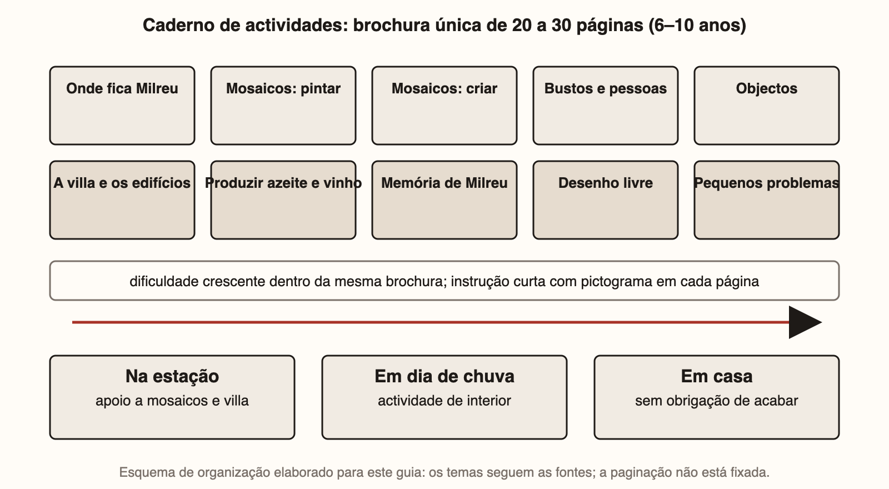

> © 2026 Fernando Rodrigues de Jácomo. Produzido no âmbito do Projecto Comunitário de Milreu. Consultar `RIGHTS.md`.

# Estação 8. Caderno de actividades

## 1. A actividade

O caderno de actividades de Milreu é uma brochura de exercícios que prolonga a experiência das estações, com tarefas que combinam observação, desenho, pintura, memória histórica, associação de informações e raciocínio lógico. Nasceu da ideia de uma cartilha de mosaicos e foi alargado para abranger diferentes aspectos do sítio. Por decisão do investigador, é uma brochura única, com cerca de 20 a 30 páginas, dirigida a crianças dos 6 aos 10 anos, com tarefas de complexidade progressiva dentro do mesmo volume. Não haverá duas edições por idade: a progressão faz-se de página para página, com campos opcionais e desafios adicionais para quem os quiser.

Os documentos de concepção prevêem seis tipos de exercício: pintar motivos de mosaicos a partir de padrões e indicações de cor; criar ou desenhar novos mosaicos a partir de motivos de referência; relacionar representações de bustos com as pessoas que retratam, quando essa associação estiver cientificamente fundamentada; descobrir informações sobre a história de Milreu, respondendo a perguntas curtas e observando imagens; completar ou produzir ilustrações, incluindo da própria villa; e resolver passatempos e desafios de lógica ligados à história e à organização do sítio. A proposta editorial do documento de adaptações organiza estes exercícios por temas: a localização de Milreu, os mosaicos, os bustos, os objectos, a villa e os seus edifícios, a produção de azeite e vinho, a memória do sítio, o desenho livre e pequenos problemas lógicos.

O conteúdo de cada página sai das publicações sobre Milreu. Os bustos permitem uma página sobre pessoas reais, porque a sua identificação está publicada: Agripina Menor, mulher do imperador Cláudio e mãe de Nero; o imperador Adriano; o imperador Galieno; e uma cabeça feminina do início do reinado de Adriano, que os autores admitem poder ser a dona da casa (Hauschild e Teichner 2002, pp. 45–46). A produção permite exercícios de sequência sobre o caminho da azeitona até ao azeite, com as prensas e a cave do lagar (pp. 33–34). Os mosaicos dão as páginas de pintura e criação, com a regra de que um motivo inventado não se apresenta como mosaico de Milreu. Onde houver resposta factual, a fonte deve ser verificável; onde houver criação livre ou hipótese, a página di-lo.

O caderno não é um exame escolar e não deve parecer um. Pode ser usado na estação de mosaicos e na montagem da villa, como apoio; como actividade de interior quando uma oficina exterior é suspensa pela chuva; como tarefa para quem espera numa rotação; e em casa, depois da visita, sem obrigação de o terminar. A paginação, o formato e a tiragem ainda não estão fixados. Para orientar a impressão, os documentos de trabalho fazem um cálculo de cenário com trinta participantes em cada uma de doze acções, o que daria 360 participações e cerca de 396 exemplares com uma reserva de 10 %, mas avisam que este número não deve ser convertido em encomenda antes de se saber o público real.

A produção do caderno está prevista para agosto de 2027 e o teste, com crianças dos 6 aos 10 anos, para setembro. Sem financiamento, o caderno tem duração própria, fora da regra dos dois meses por acção.

## 2. Dinâmica geral e objectivos da actividade

O objectivo do caderno é prolongar no tempo e no espaço o que se viveu nas estações, dando a cada criança um objecto seu, onde pode voltar a encontrar Milreu depois da visita. As tarefas trabalham observação e criatividade, mas também compreensão: perceber onde fica Milreu e porque é que ali se construiu uma villa, distinguir uma sala de uma oficina, reconhecer quem eram as pessoas retratadas nos bustos, ordenar os passos da produção do azeite.

A dinâmica depende do contexto. Na estação, o mediador indica uma ou duas páginas ligadas à actividade que a criança acabou de fazer (por exemplo, a página de criar um mosaico, depois da oficina de mosaicos) e acompanha a primeira tarefa; o resto fica para casa. Em dia de chuva, o caderno pode ser a actividade principal de uma sessão, com o mediador a ler as instruções e a conversar sobre as respostas. Em casa, a criança escolhe as páginas que quer, pela ordem que quer: o caderno não pressupõe que a criança tenha passado por todas as estações, e cada página funciona sozinha.

A diferença de autonomia entre os 6 e os 10 anos é grande, e o caderno tem de a acolher sem pressupor a mesma capacidade de leitura, escrita e interpretação para todas as crianças. Por isso, cada página tem uma instrução curta e um pictograma; as tarefas das primeiras páginas de cada tema são sobretudo visuais (pintar, ligar, encontrar diferenças); e as seguintes pedem pequenas respostas escritas, padrões a completar e relações entre edifícios e funções. As crianças mais novas podem responder oralmente a um adulto, que escreve por elas, ou resolver tarefas de associação com as peças das estações.

O caderno separa três tipos de resposta, como o Circuito em geral: a resposta factual, que tem uma fonte; a interpretação, que se apresenta como proposta; e a criação livre, que é da criança. Uma página que peça para imaginar a vida na villa deve dizer que se trata de imaginação, e uma página que pergunte quem está retratado num busto deve ter a resposta certa, com a indicação de onde se pode ver o original. As ilustrações do caderno merecem cuidado particular, porque fixam imagens na cabeça das crianças: não devem reproduzir estereótipos, por exemplo de género, na representação das pessoas da villa, nem apresentar uma reconstrução como certa.

O caderno e o livro da componente A são dois produtos diferentes para crianças sobre Milreu. O caderno é de exercícios, feito pelo projecto para as crianças; o livro conta a história de Milreu com os desenhos das próprias crianças, que são as suas autoras. Na revisão editorial, os dois serão comparados para não repetirem o mesmo conteúdo.

Os objectivos propostos são: que cada criança complete, durante ou depois da visita, pelo menos algumas páginas de temas diferentes; que as tarefas factuais sejam resolvidas com acerto; e que a criança consiga explicar uma página a um adulto. Serão verificados no teste de setembro de 2027, com crianças da idade-alvo.

O mediador recolhe, no teste, as páginas em que as crianças param ou pedem ajuda, porque é aí que o caderno terá de ser revisto antes da impressão.

## 3. Proposta por grupos de idade e quantidade de pessoas por actividade

| Grupo | Utilização | Duração |
|---|---|---|
| 6–8 | Mais pintura, ligar elementos, observar diferenças, desenho e instruções breves | Flexível |
| 9–10 | Completar padrões, relacionar funções e edifícios, exercícios de lógica e pequenas respostas escritas | Flexível |
| 11–14 | Uso facultativo de desafios adicionais, se úteis; não é público principal | Flexível |
| 15–17 | Não se destina a este grupo; os jovens usam os recursos interpretativos das outras estações | — |
| Adultos | Não se destina a este grupo; um guia patrimonial próprio para adultos pode vir a ser pensado, fora desta decisão | — |

A duração é flexível e não determinada; não existe obrigação de concluir o caderno numa única visita.

O trabalho é sobretudo individual, com um exemplar por criança. A quantidade de crianças em simultâneo depende do espaço de acompanhamento e da autonomia de cada uma, e não está fixada. Para uma turma em sessão de interior, estima-se um mediador, com o apoio do professor; numa estação de rotação, o mesmo mediador que acompanha outra actividade pode orientar quem está no caderno. O caderno precisa de mesa e cadeira quando se usa no local, e de lápis e cores.

## 4. Propostas alternativas e adicionais

O documento de adaptações prevê estudar uma versão digital ampliável do caderno, sem prometer um formato técnico ainda não produzido, que serviria pessoas com baixa visão e famílias que prefiram usar o caderno num ecrã. Uma versão com algumas indicações em braille, a avaliar, é tratada na secção de adaptações.

O caderno liga-se às estações 1, 2 e 4: a página dos bustos pode ser feita depois de os encontrar na escavação; as páginas de mosaicos depois da oficina; a página da villa depois da montagem. Pode também incluir, se o passaporte avançar, uma página de síntese do que a criança aprendeu, à maneira do «O que eu já sei!» usado no passaporte do ARQUEOLAB, descrito no capítulo da componente B.

Uma proposta para a fase de redacção é testar páginas soltas, uma a uma, nas acções pontuais da primavera e do verão de 2027, antes de fechar a brochura, para perceber que tarefas funcionam com cada idade.

## 5. Resultados esperados

Espera-se que o caderno produza, para cada criança, um conjunto de exercícios pessoais que mostre observação, criatividade e compreensão progressiva de aspectos do sítio, e que funcione como alternativa útil em dia de chuva e como continuação da visita em casa. Estas expectativas serão verificadas no teste de setembro de 2027, que deve medir quantas páginas as crianças fazem na estação, que instruções compreendem sem ajuda, onde erram e que páginas abandonam, e se a brochura de 20 a 30 páginas é demasiado longa ou demasiado curta para a idade. A brochura só será fechada depois desse teste.

## 6. Limitações

As crianças entre os 6 e os 10 anos têm diferenças grandes de leitura, de escrita e de destreza gráfica, e uma brochura única obriga a compromissos: o que é fácil para uma criança de 10 anos pode ser impossível para uma de 6. A associação entre bustos e pessoas só pode ser feita onde houver fonte, e as representações imaginadas da villa têm de ser distinguidas das reconstruções sustentadas. O formato, a paginação e a tiragem não estão fixados. O caderno impresso não é acessível, por si só, a pessoas cegas. Por fim, nenhuma fonte verificada sustenta a escolha dos exercícios para esta idade, o que torna o teste com crianças indispensável antes da impressão.

## 7. Adaptações para participantes com restrições

Cada página tem uma instrução escrita curta e um pictograma, letra legível e uma organização visual que não depende só das cores; nas páginas de pintura, as indicações de cor usam também números ou símbolos. As crianças com dificuldade de leitura podem fazer o caderno com leitura acompanhada e responder oralmente ou por ditado. As crianças com dificuldade de motricidade fina podem fazer as tarefas de associação com as peças das estações, em vez de desenhar.

Para crianças cegas ou com baixa visão, o caderno impresso não é acessível sem adaptação, e o projecto não o apresenta como tal. As alternativas são a descrição oral dos exercícios, as tarefas de associação com peças tácteis, quando o piloto o permitir, e uma eventual versão digital ampliável. A inclusão de algumas indicações em braille, como o título e as instruções principais, está em avaliação, com revisão por um leitor de braille ou entidade especializada; nem todas as crianças cegas lêem braille, sobretudo as mais novas, e por isso o braille nunca dispensa o apoio oral.

## 8. Embasamento teórico

O conteúdo do caderno tem base nas publicações sobre Milreu, que servem de matéria-prima histórica e visual para as tarefas, com página: os bustos e a sua identificação (Hauschild e Teichner 2002, pp. 45–46), a produção de azeite (pp. 33–34), a planta e os edifícios (p. 17), os mosaicos (pp. 20–22, 43–44). O parecer crítico adoptado pelo investigador lembra que estas obras permitem escolher motivos, edifícios e informações, mas não demonstram que um exercício seja adequado a uma idade.

Para a forma de fazer, há dois pontos de apoio indirectos e uma lacuna. O primeiro apoio vem do projecto Blue Voices, que levou maletas pedagógicas a escolas do Algarve entre novembro de 2025 e maio de 2026 e incluía, para as crianças dos 6 aos 10 anos, um desenho para colorir; os autores observaram que esse desenho foi bem recebido (Lopes e Baço 2026, pp. 1945–1947). É uma observação dos autores, sem instrumento de avaliação, mas é um precedente regional de uma tarefa de pintura com esta idade. O segundo apoio são dois resumos de comunicações apresentadas em 2026 no mesmo congresso: Torres e Magalhães (2026) descrevem a adaptação de textos sobre arqueologia a um público infantil num museu de arqueologia de Braga, e Solbiati (2026) alerta para os estereótipos de género nas ilustrações dos manuais escolares sobre a Pré-História, um alerta directamente aplicável às ilustrações do caderno. O projecto conhece estas duas comunicações apenas pelo resumo.

A lacuna é a seguinte: nenhuma fonte verificada trata a mediação editorial para crianças dos 6 aos 10 anos em património, nem valida a extensão, a legibilidade ou a progressão de um caderno deste tipo. Um relatório sobre participação cívica de adultos, que chegou a ser associado ao caderno, foi afastado por não tratar crianças. A avaliação também não tem fundamentação verificada e dependerá do teste com a população-alvo.

## 9. Bibliografia de referência

As obras citadas neste capítulo constam da bibliografia de referência, no final do guia.

