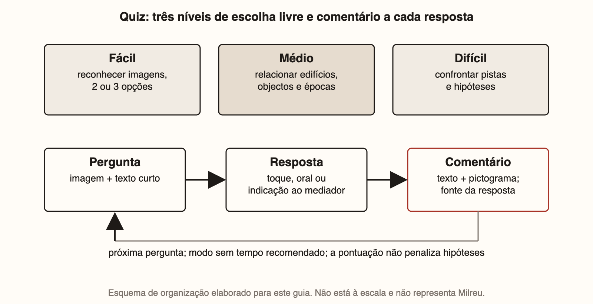

> © 2026 Fernando Rodrigues de Jácomo. Produzido no âmbito do Projecto Comunitário de Milreu. Consultar `RIGHTS.md`.

# Estação 9. Quiz histórico

## 1. A actividade

O quiz histórico de Milreu é uma sequência de perguntas e desafios digitais curtos sobre o sítio, com pontos, comentário a cada resposta e três níveis de dificuldade. Serve para retomar, no fim de uma visita ou numa pausa do circuito, o que se aprendeu nas outras estações, e para abrir novas perguntas. Os documentos de concepção prevêem personagens lúdicas que contextualizam as perguntas e acompanham o participante, para que a experiência não se reduza a uma prova escolar.

Os três níveis são o fácil, com contacto introdutório e informação clara; o médio, com relações e perguntas que exigem mais atenção e interpretação; e o difícil, com desafios que pedem mais conhecimento ou a combinação de várias pistas. Os níveis podem ser escolhidos por qualquer pessoa, independentemente da idade. O formato das respostas ainda não está fechado, e por decisão já tomada o quiz não se limita a perguntas de escolha múltipla: pode recorrer a outras formas de interacção, como ordenar imagens, associar um objecto a um edifício ou localizar um elemento numa planta, se o desenho pedagógico o justificar.

O quiz é autónomo, funciona como complemento do circuito e partilha os dispositivos da oficina digital, os dois tablets previstos, pelo que não acrescenta equipamento. Existe a possibilidade de vir a integrar o futuro jogo de construção de Milreu, mas essa integração não faz parte do seu funcionamento. A primeira versão das perguntas, com as respostas comentadas e os níveis, será preparada em agosto de 2027 e testada em setembro. Sem financiamento, o quiz só corre onde o local anfitrião tiver computador.

As perguntas saem exclusivamente de fontes verificadas sobre Milreu, e cada resposta indica a fonte. As publicações fichadas pelo projecto dão matéria para perguntas de todos os níveis, sem recorrer a datas obscuras. Por exemplo: a primeira escavação e a primeira planta do sítio deveram-se a Estácio da Veiga, em 1876 e 1877 (Hauschild e Teichner 2002, p. 10); Milreu foi classificado como Monumento Nacional em 1932 (p. 12); durante séculos julgou-se que Milreu era a cidade romana de Ossonoba, até Abel Viana demonstrar, em 1952, que Ossonoba está sob Faro (p. 10); o lagar de azeite de Milreu, com cinco prensas, é o maior conhecido da Lusitânia (Teichner e Peña Cervantes 2010/2011, p. 454); e o poeta Jorge de Sena escreveu o poema «Cabecinha Romana de Milreu», depois de ver, em 1959, no museu de Faro, um pequeno busto vindo das ruínas, e esse poema está hoje evocado num azulejo em Estoi (Jácomo 2025, pp. 257–258). Este último exemplo mostra que o quiz pode tratar também a memória do sítio, e não só a arqueologia.

Cada pergunta é guardada com a sua resposta, o comentário, o nível, a imagem usada e a referência bibliográfica com página, de modo que qualquer pessoa da equipa possa verificar de onde veio a informação e corrigir uma pergunta quando a investigação mudar. As imagens do quiz seguem as mesmas regras de direitos das outras estações: fotografias próprias autorizadas ou desenhos novos, e nunca figuras de livros sem autorização.

## 2. Dinâmica geral e objectivos da actividade

O objectivo do quiz é consolidar conhecimentos e treinar a interpretação, por meio de perguntas, imagens, pistas, comentários e níveis de dificuldade. O comentário dado a cada resposta é o centro da actividade: mais do que dizer «certo» ou «errado», explica porquê, mostra de onde vem a informação e, quando a resposta é uma hipótese dos investigadores, di-lo. Uma pergunta sobre o edifício de culto, por exemplo, só pode ter uma resposta comentada que mostre que há várias leituras em discussão; uma pergunta sobre o busto de Agripina pode ter uma resposta firme, porque a identificação está publicada.

A dinâmica é simples. O participante escolhe o nível, responde a uma pequena série de perguntas e recebe um comentário depois de cada uma, em texto e com pictograma; o áudio, se existir, é opcional e nunca é o único meio. A pontuação acompanha o percurso, mas não penaliza a exploração de hipóteses: uma resposta errada dada a uma pergunta interpretativa não deve parecer um fracasso, e o comentário deve devolver ao participante uma pista para pensar de outra maneira. O modo sem limite de tempo é o recomendado; o modo com tempo é uma opção para quem a quiser.

A graduação da dificuldade não deve basear-se só em datas difíceis de memorizar. Os documentos de concepção pedem que os níveis correspondam a diferenças observáveis de complexidade, graduando também a inferência: no fácil, reconhecer uma imagem entre duas ou três; no médio, relacionar um edifício com a sua função ou um objecto com a sua época; no difícil, combinar pistas ou confrontar duas interpretações. Uma pergunta difícil típica não é «em que ano foi construído o edifício de culto?», mas «que vestígio permite saber que este mosaico foi reparado depois do início do século IV?», com a moeda presa na argamassa como resposta (Hauschild e Teichner 2002, p. 43).

As personagens lúdicas orientam e estimulam, mas não podem apresentar hipóteses arqueológicas como certezas. Se uma personagem for, por exemplo, um habitante imaginado da villa, a sua natureza fictícia tem de ser clara, e o que diz sobre Milreu segue as mesmas regras de fonte que o resto do quiz.

O quiz pode funcionar de duas maneiras no Circuito. Como fecho de visita, retoma conteúdos das estações por onde o participante passou; como posto paralelo, ocupa quem espera por outra estação. Em ambos os casos, o mediador pode aproveitar uma resposta para uma conversa curta, que é onde o quiz deixa de ser um teste e passa a ser mediação.

Os objectivos propostos são: que o participante complete uma série de perguntas no nível escolhido, que reconheça no fim o que aprendeu e o que pode explorar a seguir, e que distinga, nas respostas comentadas, um facto documentado de uma hipótese. Serão verificados no teste de setembro de 2027.

O teste de setembro de 2027 dirá também se o quiz funciona melhor como actividade individual, no ecrã, ou como actividade colectiva, conduzida pelo mediador com equipas, e se a mesma série de perguntas pode servir crianças e adultos mudando apenas o nível. Até lá, o guia trata as duas formas como igualmente possíveis.

## 3. Proposta por grupos de idade e quantidade de pessoas por actividade

| Grupo | Tipo de pergunta predominante | Duração indicativa |
|---|---|---|
| 6–8 | Reconhecimento visual com duas ou três opções | 5–10 min |
| 9–10 | Associações factuais simples, com explicação depois da resposta | 5–10 min |
| 11–14 | Relações entre edifícios, objectos e períodos | 5–10 min |
| 15–17 | Interpretação de vestígios e confronto entre hipóteses | 5–10 min |
| Adultos | Análise de contexto e reconhecimento das incertezas históricas | 5–10 min |

A duração de cinco a dez minutos é uma estimativa do documento de adaptações; o quiz pode ser breve em eventos com rotação, desde que deixe tempo para ler os comentários.

O número de participantes depende do número de postos, dois na configuração prevista, e de o quiz ser jogado individualmente ou em grupo, decisão ainda em aberto. Uma versão colectiva, com as perguntas projectadas ou lidas pelo mediador e respostas dadas por equipas, permitiria a uma turma inteira jogar ao mesmo tempo, e pode ser experimentada no teste. O mediador é o mesmo da oficina digital.

## 4. Propostas alternativas e adicionais

Uma alternativa sem ecrã é o quiz oral ou em cartões, conduzido pelo mediador com equipas, útil quando não há dispositivos ou quando o local não tem computador. Usa as mesmas perguntas, os mesmos comentários e as mesmas fontes, e pode servir de versão acessível para quem não usa o ecrã.

O quiz pode também funcionar como síntese do passaporte, à maneira do «O que eu já sei!» do ARQUEOLAB, descrito no capítulo da componente B: no fim do circuito integrado, uma pequena série de perguntas sobre as estações visitadas mostra ao participante o que aprendeu. Para os grupos mais velhos, uma proposta adicional é pedir-lhes que escrevam uma pergunta nova para o quiz, com a fonte, o que inverte o papel e os obriga a distinguir o que é documentado do que não é.

## 5. Resultados esperados

Espera-se que o quiz produza, para cada participante, a conclusão de uma série de desafios com pontuação e comentários que lhe permitam reconhecer o que aprendeu e o que pode explorar a seguir. Estas expectativas serão verificadas no teste de setembro de 2027, que deve medir a compreensão das perguntas e dos comentários sem ajuda, a escolha efectiva dos níveis, o tempo de resposta e a existência de perguntas ambíguas ou demasiado fáceis. As perguntas e respostas terão de ser revistas cientificamente antes do uso público.

## 6. Limitações

O quiz depende de dispositivos e de software que ainda não existem, partilha os dois postos com a oficina digital e tem por isso baixa capacidade para turmas, a não ser na versão colectiva. O número de participantes por sessão, a forma das respostas e o modo individual ou colectivo ainda não estão decididos. A fiabilidade depende de cada pergunta e cada resposta serem verificadas cientificamente, o que obriga a manter as perguntas ligadas às fontes e a rever o quiz quando a investigação mudar. Um quiz pode, por natureza, empurrar para a memorização de factos, e as regras de graduação e de comentário existem para o evitar.

## 7. Adaptações para participantes com restrições

As perguntas podem ser lidas em voz alta pelo mediador, as respostas podem ser dadas oralmente e o tempo pode ser alargado ou suspenso, de modo que o quiz não penalize ritmos diferentes de leitura e de interacção. O comentário a cada resposta está sempre em texto e com pictograma, e o áudio nunca é exclusivo, o que serve pessoas surdas. Quem tenha dificuldade em tocar no ecrã com rapidez indica a resposta ao mediador. A versão em cartões ou oral serve quem não usa ecrãs. A compatibilidade com leitores de ecrã depende de implementação e de verificação próprias e não se presume.

## 8. Embasamento teórico

O conteúdo do quiz tem base nas publicações sobre Milreu fichadas pelo projecto, com página: o roteiro do sítio (Hauschild e Teichner 2002), o estudo sobre a produção de azeite e vinho (Teichner e Peña Cervantes 2010/2011) e o artigo de Jácomo (2025) sobre a história da investigação e a memória do sítio, onde se conta a relação de Jorge de Sena com Milreu.

Para a forma do quiz, as fontes disponíveis são revisões gerais sobre jogos sérios, que o projecto conhece pelo resumo. Mortara et al. (2014) oferecem uma tipologia de jogos sérios no património cultural, útil para situar o quiz. Bellotti et al. (2013) mostram que a eficácia destes jogos é pouco estudada e discutem o papel do comentário dado ao jogador e da personalização, que é exactamente o que o quiz pretende cuidar. Boyle et al. (2016), numa revisão de 143 estudos, concluíram que a aquisição de conhecimento é o resultado mais referido dos jogos de aprendizagem, mas pedem estudos que mostrem que características produzem esse efeito.

Há ainda um apoio indirecto para a regra de não penalizar as respostas interpretativas. No projecto *Património Vivo para a Infância*, em Braga, as autoras leram os «erros» das crianças dos 6 aos 10 anos, como desenhar uma moeda romana como uma moeda digital, como traduções culturais e não como enganos (Brito et al. 2026, pp. 1853–1855). Um quiz que trate todas as respostas diferentes como falhas perde essa oportunidade de conversa.

Nenhuma fonte verificada trata o desenho de quizzes por idades nem valida os três níveis previstos. O parecer crítico adoptado pelo investigador pede que se separe a exactidão histórica das perguntas, que as fontes garantem, do efeito pedagógico do quiz, que só a avaliação poderá mostrar.

## 9. Bibliografia de referência

As obras citadas neste capítulo constam da bibliografia de referência, no final do guia.

