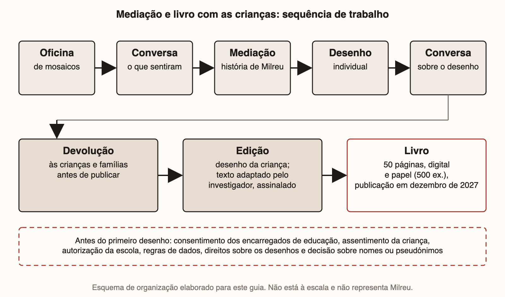

> © 2026 Fernando Rodrigues de Jácomo. Produzido no âmbito do Projecto Comunitário de Milreu. Consultar `RIGHTS.md`.

# Componente A. Mediação cultural e livro com as crianças

## 1. A actividade

A componente A junta duas coisas que se seguem uma à outra: uma mediação com as crianças depois das oficinas de mosaicos e um livro, feito a partir dos desenhos dessas crianças, que conta a história de Milreu e dos seus mosaicos. É a componente do Circuito em que as crianças deixam de ser apenas público e passam a ser autoras.

A mediação acontece depois das oficinas de mosaicos com turmas do 1.º e do 2.º ciclos do ensino básico. Primeiro, as crianças falam sobre o que sentiram e o que lhes ficou da oficina. Depois, ouvem e conversam sobre a história de Milreu, numa mediação que pode ser feita com a ajuda da equipa das Ruínas de Milreu, que já faz mediação no sítio, se essa equipa o acordar. Propõe-se, a acordar, que a equipa das ruínas, do Património Cultural, I.P., possa ajudar na mediação e disponibilizar espaço no sítio para estas sessões; como principal parte interessada do Circuito, será informada e convidada a participar nas decisões sobre o conteúdo do livro que diga respeito a Milreu. Em seguida, as crianças desenham: mosaicos, como nas oficinas, mas também as partes da história de Milreu que mais lhes chamaram a atenção. Por fim, conversam entre si sobre os desenhos, e as suas palavras ficam registadas.

O livro reúne esses desenhos. As crianças do concelho são as autoras dos desenhos, e o livro diz-o. O investigador adapta o texto e as legendas dos desenhos, a partir das conversas e da bibliografia sobre Milreu, e o livro identifica essa adaptação como sua. Por decisão do investigador de 21 de novembro de 2026, o livro terá cerca de 50 páginas, uma tiragem de 500 exemplares em papel e uma versão digital, será distribuído pelo concelho de Faro e será publicado em dezembro de 2027. Sem financiamento, sai apenas a versão digital. A possibilidade de publicar também as palavras de cada criança sobre o seu desenho, ao lado do texto adaptado, é uma opção editorial ainda não decidida.

A publicação em dezembro de 2027 tem consequências para o calendário de trabalho. A recolha de desenhos começa com as primeiras oficinas de mosaicos com turmas, a partir de fevereiro de 2027, e tem de terminar com tempo para a selecção, a digitalização, a escrita do texto, a devolução às crianças e às famílias, a revisão e a impressão; o calendário interno será fixado com as escolas participantes e com quem fizer a edição. A componente não tem «acção» própria no cronograma: corre em paralelo com as oficinas e com as acções pontuais de 2027.

O material de cada sessão é simples: papel de desenho, lápis de cor, marcadores e ceras, pranchetas, uma pasta por turma para guardar os originais sem os dobrar e as autorizações dos encarregados de educação. A edição implica ainda a digitalização dos desenhos, a paginação, a revisão editorial e científica, o registo do livro e a sua distribuição, tarefas cuja responsabilidade, com excepção do texto do investigador, ainda não está atribuída. A editora, o ISBN, o depósito legal e o circuito de distribuição pelo concelho estão por decidir.

## 2. Dinâmica geral e objectivos da actividade

A componente tem dois objectivos ligados. O primeiro é ouvir as crianças sobre o que viveram nas oficinas e sobre o que entendem de Milreu, em vez de apenas lhes transmitir informação. O segundo é devolver a história de Milreu ao concelho, num livro em que as crianças são autoras dos desenhos. Os dois objectivos respondem a um dos problemas que deram origem ao Circuito, a pouca participação dos estudantes do concelho na vida das ruínas, e aos princípios do projecto: a comunidade fala primeiro e a instituição enquadra, com as duas vozes distinguíveis.

A sessão de mediação dura uma parte de uma manhã ou de uma tarde escolar e segue a ordem descrita no esquema. A conversa inicial sobre a oficina é curta e aberta: o que gostaram de fazer, o que foi difícil, o que lhes lembrou o mosaico. A mediação sobre a história de Milreu deve incluir experiência e não só narração: uma imagem para observar, um objecto para mexer, uma pergunta para resolver. As fontes que o projecto leu mostram que os desenhos das crianças vieram depois de experiências vividas, como visitas, escavações e jogos, e não depois de uma explicação, e a mediação procura essa qualidade. O conteúdo vem das publicações sobre o sítio, e a equipa do sítio, se participar, traz o seu próprio conhecimento da mediação nas ruínas.

O desenho é individual e livre dentro de dois temas: os mosaicos e as partes da história de Milreu que a criança escolher. O mediador não corrige o desenho nem sugere o que deve aparecer. A conversa sobre o desenho faz-se entre pares, em grupos de dois ou três, com o mediador a ouvir e a registar o que cada criança diz sobre o seu desenho, por escrito e sem gravação de imagem, salvo autorização específica. Esta conversa é a matéria-prima do texto do livro, e a palavra da criança é o ponto de partida da legenda.

Antes da publicação, há um momento de devolução: as crianças e as famílias vêem o que será publicado e podem pedir correcções ou retirar um desenho. A devolução faz-se nas escolas ou numa sessão própria e faz parte da actividade, por razões éticas e pedagógicas.

Na edição, o investigador escreve o texto e as legendas, assinalando que são uma adaptação sua, e cuida de duas separações. A primeira é visual e de autoria: o que é da criança (o desenho e, se se decidir publicá-las, as suas palavras) distingue-se do que é do investigador. A segunda é de conteúdo: o que é fantasia infantil distingue-se do que é conhecimento sobre Milreu. Um desenho em que um gato romano guarda o peristilo é bem-vindo no livro, e a legenda diz que é imaginação da criança; um desenho do lagar acompanha-se de uma legenda que explica o que ali se fazia, com base nas fontes. Esta regra aplica ao livro o que o Circuito aplica em todas as estações.

Os objectivos de aprendizagem e de participação propostos são três: que as crianças expressem, por desenho e por palavras, o que entenderam de Milreu; que reconheçam no livro o seu trabalho e o dos colegas; e que as famílias e a comunidade do concelho recebam um objecto que conta Milreu a partir do olhar das crianças. Nenhum destes objectivos foi ainda verificado.

## 3. Proposta por grupos de idade e quantidade de pessoas por actividade

| Grupo | Forma de participação | Duração indicativa da sessão |
|---|---|---|
| 6–8 (1.º ciclo) | Conversa curta, desenho livre, palavras ditas ao adulto ou a um colega; as crianças desenham mais do que escrevem | a fixar no teste |
| 9–10 (1.º ciclo) | Conversa, desenho e uma frase escrita sobre o desenho, se quiserem | a fixar no teste |
| 11–12 (2.º ciclo) | Conversa mais longa, desenho de uma parte da história escolhida, legenda proposta pela própria criança | a fixar no teste |

A componente dirige-se às crianças do 1.º e 2.º ciclos, ou seja, aproximadamente dos 6 aos 12 anos, abrangendo os grupos de 6 a 8 e de 9 a 10 anos e parte do grupo de 11 a 14. Não há duração validada para a sessão; a do projecto de Braga descrito no embasamento não é transferível sem teste.

A unidade de trabalho é a turma, com o desenho individual e a conversa em pares ou trios. A participação exige consentimento por criança, pelo que a componente só se faz com grupos escolares ou com grupos inscritos e autorizados. Em eventos abertos, as crianças podem desenhar, mas esses desenhos ficam como devolução local e não entram no livro. Os mediadores previstos são o investigador, a equipa das Ruínas de Milreu se houver acordo, e os professores da turma, cuja presença é necessária. Uma turma de 25 crianças pede, pelo menos, duas pessoas a ouvir e registar as conversas.

## 4. Propostas alternativas e adicionais

A opção editorial ainda aberta é a de publicar, ao lado do texto adaptado, as palavras de cada criança sobre o seu desenho, transcritas e separadas do texto do investigador; a análise bibliográfica do projecto sugere-a, porque mantém visível a voz da criança, e a decisão cabe ao investigador. Outra opção é deixar que cada criança reveja a versão final da sua página antes da impressão.

A mediação pode também ser feita depois de outras estações, e não só da oficina de mosaicos, porque as experiências de escavação, de estratigrafia ou de montagem da villa dão matéria para desenhar. O livro pode ser um dos prémios do passaporte, entregue no museu a quem o completar, se o museu o acordar. Por fim, a versão digital pode ser acompanhada de uma leitura em voz alta ou de uma versão ampliada, a estudar.

## 5. Resultados esperados

Espera-se um conjunto de desenhos e de palavras de crianças do concelho sobre Milreu, recolhido com autorização, devolvido às crianças e às famílias e publicado num livro de cerca de 50 páginas, em papel e em digital, em dezembro de 2027. Espera-se que os desenhos e as conversas mostrem o que as crianças entenderam e imaginaram sobre o sítio, e que essa informação sirva também para avaliar as oficinas. Estas expectativas dependem de condições ainda por cumprir, sobretudo as autorizações e a política de menores, e de se encontrarem escolas participantes. Nenhum resultado desta componente existe ainda.

## 6. Limitações

A componente está bloqueada pela política de trabalho com menores, descrita no capítulo final: nenhum desenho pode ser recolhido para publicação antes de existirem os formulários de consentimento, o assentimento das crianças, a autorização das escolas, as regras de protecção de dados e as decisões sobre os direitos dos desenhos e sobre o uso de nomes reais ou de pseudónimos. A participação da equipa das Ruínas de Milreu não está acordada. A editora, o ISBN, a distribuição e o responsável pela paginação estão por decidir. O calendário é apertado: com publicação em dezembro de 2027, a recolha e a devolução têm de caber no ano lectivo e no início do seguinte.

Há também uma tensão de método, que o projecto assume. As fontes que inspiram a componente criticam a mediação do adulto sobre a voz das crianças, e a adaptação do texto pelo investigador reintroduz essa mediação. A separação visual entre o que é da criança e o que é do investigador, e a identificação da adaptação como sua, são a forma de tornar essa mediação visível, mas não a eliminam. Por fim, o livro e o caderno de actividades são dois produtos para crianças sobre Milreu, e a revisão terá de evitar que repitam o mesmo conteúdo.

## 7. Adaptações para participantes com restrições

Para não excluir autores, a componente aceita outras formas de expressão além do desenho: a palavra dita, a modelação, a colagem ou a composição com tesselas, fotografada. Uma criança com deficiência visual ou com dificuldade de motricidade fina pode ser autora de uma página por estas vias. As crianças que ainda não escrevem ou escrevem com dificuldade ditam as suas palavras a um adulto. Para crianças surdas, a mediação usa texto, imagem e pictogramas; a interpretação em língua gestual portuguesa não faz parte da proposta principal e só será considerada se o grupo o pedir e se for possível organizá-la. A versão digital do livro deverá ser legível por leitores de ecrã e ampliável, o que será verificado na edição; a inclusão de indicações em braille na edição em papel está em avaliação.

## 8. Embasamento teórico

O precedente mais próximo desta componente é o projecto educativo *Património Vivo para a Infância*, realizado em julho de 2025, no âmbito de uma escola de verão luso-brasileira, entre o Teatro Romano de Braga, uma escola básica e a Casa do Conhecimento de Vila Verde. Participaram 34 crianças dos 6 aos 10 anos, de duas escolas de Vila Verde em territórios de vulnerabilidade socioeconómica, muitas das quais nunca tinham visitado um museu ou um sítio arqueológico. As crianças visitaram o teatro romano, participaram em actividades ligadas à escavação e em jogos de procura de moedas, fotografaram e, no fim, fizeram um desenho livre, seguido de uma conversa entre pares sobre esse desenho, o «desenho-conversado». As autoras analisaram os desenhos e as palavras por análise temática e mostraram que as crianças constroem sentido sobre o património juntando o corpo, a brincadeira, os afectos, as memórias de família, a imaginação e referências dos media; leram os «erros» das crianças, como uma moeda romana desenhada como moeda digital, como tradução cultural e não como engano. Obtiveram o consentimento informado dos encarregados de educação e o assentimento das crianças e fizeram uma devolução pública dos resultados, apresentada como momento ético (Brito et al. 2026, pp. 1852–1856). O estudo não mede aprendizagem e não trata da publicação de livros nem da autoria editorial: a «co-autoria» de que fala é o reconhecimento da criança como intérprete legítima do património.

Num ensaio publicado nas mesmas actas, Brito (2026, pp. 1640, 1642–1644) resume a arqueologia da infância e defende que as crianças podem ser interlocutoras legítimas na interpretação do património, sem que a imaginação substitua o rigor científico. É um ensaio, e o próprio autor diz que o projecto de Braga lhe serve de ilustração e não de objecto de avaliação.

A sociologia da infância dá o enquadramento geral, que o projecto cita sem lhe atribuir resultados sobre património. Corsaro (2015), na introdução e no glossário da sua obra, descreve as crianças como agentes que produzem culturas próprias e se apropriam de forma criativa da informação adulta, a que chama reprodução interpretativa. Prout (2010) critica a ideia de que a «voz» e a «agência» da criança são dadas à partida e mostra que elas se exercem dentro de redes de pessoas e objectos; para um livro em que intervêm crianças, professores, mediadores, investigador e município, isto aconselha tornar visível o papel de cada adulto. Guardado (2018), também indicado pelo investigador, estuda a socialização na língua de herança em famílias migrantes, e não o património cultural; cita-se apenas como contexto geral de socialização e discurso. A colectânea de Darian-Smith e Pascoe (2013) sobre crianças e património cultural e o texto de Bodén (2021) sobre ética na investigação com crianças são leituras previstas que o projecto ainda não fez.

O conceito de «fabulação infantil», referido no pedido do investigador, não aparece nas obras lidas. E nenhuma fonte verificada avalia um livro infantil feito com desenhos de crianças, nem trata a autoria, os direitos ou a retirada de desenhos de menores numa publicação. O formato do livro é, por isso, uma proposta do projecto, sustentada no procedimento de Braga para a recolha e sem precedente para a edição.

## 9. Bibliografia de referência

As obras citadas neste capítulo constam da bibliografia de referência, no final do guia.

