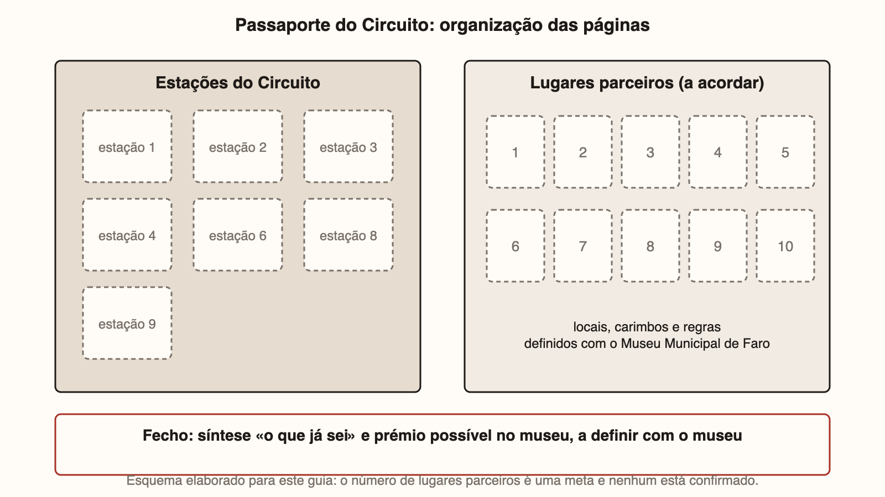

> © 2026 Fernando Rodrigues de Jácomo. Produzido no âmbito do Projecto Comunitário de Milreu. Consultar `RIGHTS.md`.

# Componente B. Passaporte do Circuito

## 1. A actividade

O passaporte do Circuito é um livrete de bolso, no formato de um passaporte, que acompanha a pessoa ao longo do circuito integrado e regista, com um carimbo, cada estação que ela conclui. Quando as estações estiverem disponíveis e testadas, o Circuito será apresentado em conjunto, orientado por voluntários e por parceiros institucionais, e o passaporte dá forma visível a esse percurso: no fim, a pessoa leva consigo um objecto com os sinais das actividades que fez.

O projecto prevê uma tiragem de 500 livretos de 20 páginas, em brochura, com papel que aceite a tinta dos carimbos. As páginas reservam um espaço para cada estação do Circuito, isto é, as estações 1, 2, 3, 4 e 6 e, se o museu acordar que também dão carimbo, o caderno (8) e o quiz (9), e um conjunto de espaços para lugares parceiros. A ideia do investigador é que o passaporte possa receber também carimbos de outros monumentos e museus do concelho, tanto da administração municipal como de outras tutelas, como as próprias Ruínas Romanas de Milreu, de modo que a pessoa seja convidada a visitar outros lugares de património da região e a completar o passaporte. A meta indicada no pedido do investigador é de cerca de dez lugares, e os seis sugeridos para avaliação são o Museu Municipal de Faro, o Museu Regional do Algarve, as Ruínas Romanas de Milreu, o Centro Ciência Viva do Algarve, o Centro Interpretativo do Arco da Vila e o Museu Marítimo «Almirante Ramalho Ortigão». Estes lugares pertencem a tutelas diferentes, e nenhum está confirmado: os locais, os carimbos e as regras ficam por definir com o Museu Municipal de Faro, e cada entidade terá de concordar por escrito.

Propõe-se que, com o passaporte completo, a pessoa possa dirigir-se ao Museu Municipal de Faro, instituição de apoio do Circuito, e receber um prémio, se o museu o aceitar. O pedido do investigador refere como possibilidades livros produzidos pelo projecto, brindes do museu ou a entrada gratuita de duas pessoas num museu de Faro durante um período definido. Todas estas possibilidades dependem de decisão das entidades envolvidas: uma entrada gratuita é decidida por cada entidade, e o projecto só a pode propor.

O material da componente são os livretos, um carimbo por estação, com desenho próprio, as almofadas e a tinta, e, nos lugares parceiros que aderirem, os carimbos desses lugares, fornecidos pelo projecto ou pela própria instituição, conforme se acordar. A paginação e o desenho do passaporte serão feitos pelo projecto. A preparação está prevista para agosto e setembro de 2027, porque o passaporte só faz sentido com as estações operacionais, e a primeira utilização no evento integrado de outubro de 2027. O passaporte só entra no cenário com apoio; sem financiamento, fica de fora.

O passaporte é distribuído à entrada do evento integrado, com uma explicação curta das regras em texto e pictogramas, e os carimbos ficam em cada estação, à guarda do mediador. O formato de bolso foi escolhido para que o passaporte se transporte facilmente numa visita e para que possa servir, depois do evento, de convite a voltar ao património do concelho. O livrete não tem ainda desenho gráfico, e as páginas mostradas no esquema seguinte são apenas uma proposta de organização.

## 2. Dinâmica geral e objectivos da actividade

O passaporte tem três objectivos. O primeiro é ligar as estações do Circuito entre si, dando à pessoa uma razão para passar por várias e uma forma de ver o que já fez. O segundo é ligar o Circuito a outros lugares de património do concelho, convidando as famílias e os grupos a visitá-los depois do evento. O terceiro é fechar o percurso com uma síntese, em que a pessoa reconhece o que aprendeu.

No circuito integrado, a dinâmica é a seguinte. A pessoa recebe o passaporte à entrada, com uma explicação curta das regras, escrita e com pictogramas. Em cada estação, o mediador carimba o espaço correspondente quando a actividade é concluída. Concluir uma actividade significa ter participado na sua tarefa central e na partilha final, e não ter acertado em todas as respostas: o carimbo não é uma nota. Que componentes complementares dão carimbo, por exemplo o caderno ou o quiz, é uma regra a acordar com o museu. No fim do percurso, uma página de síntese convida a pessoa a escrever ou desenhar o que aprendeu, à maneira da página «O que eu já sei!» usada no ARQUEOLAB, e pode ser completada com uma pequena série de perguntas do quiz.

Fora do evento, o passaporte continua a funcionar se houver lugares parceiros. A pessoa visita um museu ou monumento aderente, por conta própria, e pede o carimbo desse lugar ao pessoal da recepção. Esta extensão não depende do Circuito e por isso não deve ser condição do carimbo das estações: o núcleo do passaporte é o carimbo por estação no evento integrado, que só depende do projecto, e a extensão aos lugares parceiros é uma camada adicional.

O passaporte levanta uma questão de dados pessoais, que o guia trata com cuidado. O pedido inicial previa que o passaporte tivesse os dados da pessoa, para efeitos do prémio. Quando o titular é uma criança, isso significa recolher dados de menores. O guia propõe, até haver decisão com o encarregado de protecção de dados do Município, uma versão sem dados pessoais, em que o prémio se entrega a quem apresentar o passaporte completo, sem registo nominal. Se se optar por uma versão nominal, ela terá de cumprir as regras de minimização, de informação e de conservação dos dados e a política de menores descrita no capítulo final.

Os objectivos propostos para a componente, a verificar no evento integrado e nas acções seguintes, são: que uma parte dos participantes do evento passe por várias estações e o registe; que a página de síntese seja preenchida; e, se houver lugares parceiros, que alguns passaportes voltem ao museu com carimbos externos. A proporção esperada em cada caso não pode ser estimada antes de haver dados.

O passaporte não substitui a mediação de cada estação nem a avaliação do Circuito. É um instrumento de organização e de memória do percurso, e a sua utilidade será medida pela forma como os participantes o usam no evento, e não pelo número de carimbos acumulados.

Os mediadores de cada estação recebem, na capacitação prévia, a regra de carimbo e a explicação a dar a quem pergunte pelo prémio, para que a resposta seja a mesma em todas as estações e não se prometa nada que o museu não tenha aceitado.

## 3. Proposta por grupos de idade e quantidade de pessoas por actividade

| Grupo | Forma de uso | Observações |
|---|---|---|
| 6–8 | Passaporte acompanhado por um adulto; carimbo e desenho na página de síntese | Visitas a lugares parceiros só com a família |
| 9–10 | Uso autónomo no evento; síntese com frases curtas | Idem |
| 11–14 | Uso autónomo; síntese escrita | Pode servir de guia de visita autónoma com a família ou a escola |
| 15–17 | Uso autónomo; síntese escrita e, se quiserem, pergunta nova para o quiz | Pode ser menos atractivo para este grupo, a verificar |
| Adultos | Uso autónomo ou em família | Possível incentivo para visitar outros lugares do concelho |

O passaporte não tem duração própria: dura o tempo do circuito integrado e, para os lugares parceiros, o tempo que a pessoa quiser, dentro do período de validade do prémio que vier a ser definido.

Distribui-se um passaporte por pessoa, até ao limite da tiragem. Os carimbos das estações são dados pelos mediadores de cada estação, sem pessoal adicional; nos lugares parceiros, pelo pessoal desses lugares, se aderirem. A entrega do prémio no museu depende do serviço do museu.

## 4. Propostas alternativas e adicionais

Uma alternativa de menor escala, que não depende de nenhum parceiro externo, é usar o passaporte apenas dentro do evento, com os carimbos das estações e a página de síntese, sem lugares parceiros nem prémio; é esta a versão que o projecto pode garantir por si. Outra possibilidade é integrar as Ruínas Romanas de Milreu como lugar de carimbo, se a entidade gestora concordar. Se o livro da componente A estiver publicado a tempo, pode ser um dos prémios, decisão a tomar com o museu.

Na componente para adolescentes, uma visita a um centro de investigação ou a um sítio em escavação poderia dar um carimbo extra, possibilidade a avaliar. Para pessoas cegas ou com baixa visão, uma versão com relevo ou um cartão táctil é tratada na secção de adaptações.

## 5. Resultados esperados

Espera-se que, no evento integrado de outubro de 2027, os participantes recebam o passaporte, o carimbem nas estações que concluírem e preencham a página de síntese, e que o passaporte ajude a organizar o percurso entre estações. Se houver lugares parceiros, espera-se que algumas pessoas visitem pelo menos um desses lugares depois do evento, o que só poderá ser verificado se o museu registar, de forma anónima, os passaportes apresentados. Estas expectativas não têm, por agora, nenhuma base de comparação, e o evento de outubro deve servir de primeiro teste.

## 6. Limitações

A extensão aos lugares parceiros depende de acordos com várias tutelas diferentes, nenhum dos quais existe, e de faltarem ainda cerca de quatro lugares para a meta de dez. O prémio depende de decisão do museu e de cada entidade. O passaporte depende de todas as estações estarem operacionais, e por isso o seu calendário depende do de todo o Circuito. A recolha de dados pessoais, se existir, implica obrigações de protecção de dados, em especial para menores.

Há também limitações de equidade. As crianças pequenas precisam de um adulto para visitar outros lugares, e o objectivo de completar o passaporte pode ficar fora do alcance de famílias sem transporte ou sem tempo; o prémio não deve, por isso, ser a razão principal da actividade. Os lugares parceiros têm condições de acessibilidade diferentes, e o passaporte não pode prometer o que cada lugar não garante.

## 7. Adaptações para participantes com restrições

O passaporte tem texto curto, letra legível e pictogramas em todas as páginas, e as regras não dependem de explicação oral. Os carimbos e as páginas são visuais, pelo que, para pessoas cegas ou com baixa visão, se avalia uma versão com relevo ou um cartão táctil, se o piloto táctil o permitir, e a inclusão de indicações em braille nas páginas principais, revistas por um leitor de braille ou entidade especializada. Para quem não pode escrever, a página de síntese aceita desenho ou resposta ditada. Para quem não pode percorrer todas as estações, o carimbo de uma estação adaptada vale o mesmo que o da estação regular.

## 8. Embasamento teórico

O precedente português directo é o passaporte do ARQUEOLAB, a actividade apresentada por uma equipa do Porto na Noite Europeia dos Investigadores de 26 de setembro de 2025. Era um desdobrável que registava a conclusão de cada uma das três actividades do expositor com um autocolante; depois das três, o participante lia os resultados de aprendizagem esperados, numa secção intitulada «O que eu já sei!», e o verso tinha textos curtos sobre o que é a arqueologia, uma barra cronológica e uma ligação para uma página na internet (Vale et al. 2026, pp. 1863, 1865). A diferença de escala é grande: o ARQUEOLAB tinha três jogos numa noite, num só expositor, e o passaporte do Circuito prevê várias estações e lugares do concelho, com recompensa institucional. O artigo não diz quantas pessoas completaram o passaporte nem se alguma o abandonou.

Para a extensão a vários lugares, há um enquadramento possível numa comunicação apresentada no mesmo congresso sobre redes de sítios arqueológicos e turismo arqueológico (Naldinho et al. 2026), que o projecto conhece apenas pelo resumo. A revisão de Malegiannaki e Daradoumis (2017) sobre 34 jogos ligados a lugares culturais, também conhecida pelo resumo, serve para pensar o passaporte como jogo de lugar. E a revisão de Hamari et al. (2014) sobre gamificação, isto é, sobre o uso de carimbos, colecções e prémios fora dos jogos, aponta, segundo resumos secundários, para efeitos parciais e dependentes do contexto e das pessoas; o projecto só verificou a existência desta obra.

Nenhuma das fontes lidas avalia um passaporte cultural com vários lugares e prémio, nem a adesão, a conclusão ou o efeito nas visitas a museus. O formato do núcleo, com um carimbo por estação e uma síntese final, tem precedente; a extensão ao concelho e o prémio são propostas do projecto, sem fundamentação verificada.

## 9. Bibliografia de referência

As obras citadas neste capítulo constam da bibliografia de referência, no final do guia.

