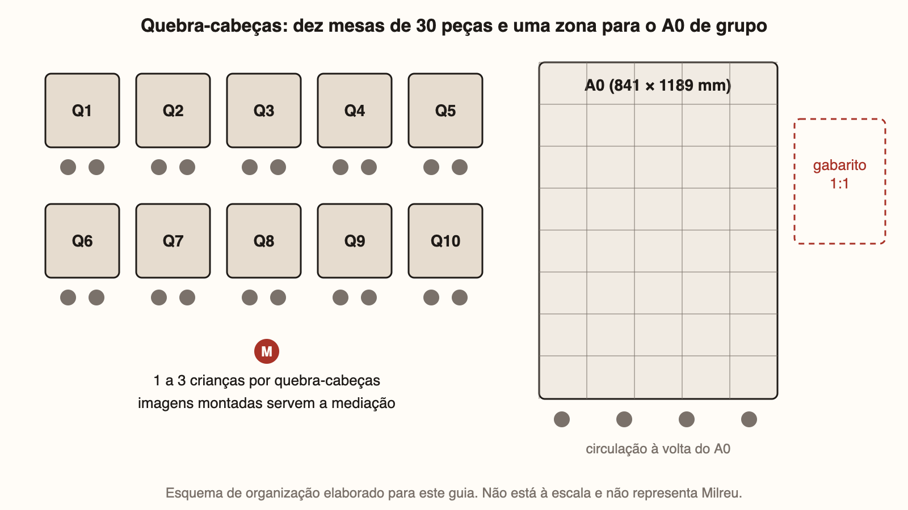

> © 2026 Fernando Rodrigues de Jácomo. Produzido no âmbito do Projecto Comunitário de Milreu. Consultar `RIGHTS.md`.

# Componente C. Quebra-cabeças

## 1. A actividade

A componente C é uma medida alternativa e opcional do Circuito: um conjunto de dez quebra-cabeças diferentes, de 30 peças cada, para crianças dos 6 aos 12 anos, com imagens de mosaicos, de estratigrafia, de construções e da planta de Milreu, e, como alternativa, um quebra-cabeças grande, em formato A0, montado em grupo. Depois de montadas, as imagens dos quebra-cabeças servem de ponto de partida para conversas de mediação sobre o que mostram.

Os dez quebra-cabeças têm dez desenhos diferentes, por decisão do investigador, e não dez cópias do mesmo. A distribuição dos dez pelos quatro temas ainda não está feita. Cada quebra-cabeças terá a sua caixa ou bolsa, identificada pelo tema, e peças de reserva. O material e o fabrico (cartão rígido ou madeira, com as regras de segurança de brinquedo aplicáveis) serão definidos na produção.

O quebra-cabeças de grupo tem o formato A0, isto é, 841 × 1189 mm, e peças grandes, com 10 a 15 cm de lado, segundo a expectativa do investigador. Com peças quadradas deste tamanho, um A0 dá entre cerca de 40 peças, se tiverem 15 cm, e cerca de 96, se tiverem 10 cm; a medida final fecha-se com quem o fabricar. O A0 é acompanhado de um gabarito, uma base à escala real com os contornos das peças e, eventualmente, a imagem-guia, que ajuda as crianças com dificuldades de qualquer tipo a identificar onde vai cada peça.

As imagens são a parte mais delicada da componente. Só podem usar-se fotografias próprias do projecto, com autorização da entidade que gere as ruínas quando forem do sítio, ou desenhos novos feitos para o efeito. As figuras do roteiro de Milreu e de outros livros não se reproduzem sem autorização, e as reconstruções que entrarem nos quebra-cabeças são marcadas como interpretação. O tema da estratigrafia exige um cuidado próprio, explicado no embasamento: o perfil desenhado não pode misturar paleontologia com arqueologia nem sugerir que o mais fundo é sempre o mais antigo.

A produção pode fazer-se a qualquer momento de 2027, depois de resolvidos os direitos das imagens; a componente não tem mês de preparação nem de teste próprio no cronograma. Entra apenas no cenário com apoio: sem financiamento, fica de fora.

Os quatro temas foram escolhidos para corresponder às estações físicas do Circuito: os mosaicos ligam-se à estação 2, a estratigrafia à estação 3, as construções e a planta de Milreu à estação 4. Uma distribuição possível, a decidir na produção, seria reservar mais quebra-cabeças aos mosaicos e às construções, que oferecem imagens mais variadas, e menos à estratigrafia, que exige mais cuidado de conteúdo. Cada caixa leva uma etiqueta com o tema e uma pequena ficha para o mediador, com o que a imagem mostra, a fonte da informação e uma ou duas perguntas para a conversa final. Os quebra-cabeças contam-se peça a peça no fim de cada sessão, e as peças perdidas repõem-se a partir da reserva.

O conjunto ocupa pouco peso, mas algum volume, sobretudo o A0, que se transporta numa caixa plana, num tubo ou num saco próprio.

## 2. Dinâmica geral e objectivos da actividade

Os quebra-cabeças têm três objectivos. O primeiro é fazer as crianças olhar com atenção para uma imagem de Milreu, porque montar um quebra-cabeças obriga a observar cores, linhas, formas e pormenores que passariam despercebidos numa olhadela. O segundo é rever, de forma lúdica, os temas das estações (mosaicos, estratigrafia, edifícios, planta). O terceiro é ligar a imagem ao sítio real, pela conversa com o mediador sobre o vestígio que ela representa e sobre a fonte da informação.

A dinâmica com os dez quebra-cabeças é a de uma mesa de trabalho em pequenos grupos. Cada criança, ou cada par ou trio, recebe um quebra-cabeças, monta-o e, no fim, conversa com o mediador sobre o que a imagem mostra: que tipo de mosaico é, onde fica aquele edifício na planta, que camada está em cima. A montagem pode ser o início de uma visita, para preparar o olhar, ou o fim, para rever. Numa turma, os dez quebra-cabeças podem ser montados em paralelo e trocados entre grupos.

O quebra-cabeças A0 é uma actividade colectiva. Um grupo de crianças monta-o em conjunto, numa mesa grande ou no chão, distribuindo as peças e negociando entre si onde vai cada uma. O gabarito fica ao lado, ou por baixo, e o mediador decide com o grupo quando usá-lo. A dinâmica valoriza a cooperação: a imagem completa é de todos, e o mediador pede no fim que o grupo explique o que montou.

Os documentos de concepção previam que as imagens montadas servissem de pistas a uma caça ao tesouro nas ruínas. Essa caça ao tesouro saiu do escopo actual do Circuito na redução decidida pelo investigador em 21 de novembro de 2026, e as imagens deixaram de ter essa função. A ligação ao sítio faz-se agora pela mediação: com a ficha da caixa, o mediador diz o que a imagem mostra e de onde vem a informação, e, quando a sessão antecede ou segue uma visita às ruínas, pode indicar em que parte do sítio se encontra o vestígio representado, sem transformar essa indicação num percurso de procura.

O formato único de 30 peças para crianças dos 6 aos 12 anos junta crianças com destrezas muito diferentes. O mediador ajusta a dificuldade com o que tem à mão: para as mais novas, mostra a imagem completa e deixa montar em grupo; para as mais velhas, retira a imagem de referência ou propõe montar contra o tempo, sem que o tempo seja uma regra obrigatória. Se o teste mostrar que 30 peças são poucas ou demasiadas para algum grupo, a produção pode incluir variantes de dificuldade.

Os objectivos propostos, a verificar quando os quebra-cabeças forem usados com crianças, são: montar a imagem em pequeno grupo; dizer o que ela mostra; e relacioná-la com o tema da estação de onde vem.

Em dia de chuva, os quebra-cabeças são uma das actividades de interior mais fáceis de organizar, porque não precisam de energia, de rede nem de materiais soltos, e podem receber de uma vez um grupo grande. Também servem de tarefa para quem espera numa rotação, desde que o mediador garanta que a montagem não fica a meio quando o grupo muda de estação.

O mediador regista, nas primeiras utilizações, quanto tempo cada grupo demora e que imagens são mais difíceis, para decidir se vale a pena produzir variantes.

## 3. Proposta por grupos de idade e quantidade de pessoas por actividade

| Grupo | Uso previsto | Pessoas por quebra-cabeças | Duração |
|---|---|---|---|
| 6–8 | Montagem em grupo, com a imagem de referência à vista; A0 com gabarito | 2–3 | a medir |
| 9–10 | Montagem em par ou individual; conversa sobre o tema | 1–2 | a medir |
| 11–12 | Montagem individual, sem imagem de referência; conversa sobre o vestígio representado e a fonte | 1–2 | a medir |
| A0 de grupo | Montagem colectiva por várias crianças, com gabarito | um grupo, de tamanho a fixar no teste | a medir |

Não há dados de duração para estes quebra-cabeças. O precedente regional descrito no embasamento observou que quebra-cabeças de 20 peças foram montados depressa por crianças dos 6 aos 10 anos, o que sugere que 30 peças serão uma tarefa curta para muitas crianças, mas a duração real será medida no primeiro uso.

Os dez quebra-cabeças servem, em simultâneo, entre dez e trinta crianças, o que permite ocupar uma turma inteira. Um mediador basta para o conjunto, com o apoio do professor. O A0 precisa de cerca de 1 m² livre e de circulação à volta, e de um mediador que acompanhe o grupo. Em evento aberto, a componente funciona como posto de entrada livre e é útil em dia de chuva.

## 4. Propostas alternativas e adicionais

O A0 é a alternativa principal aos dez quebra-cabeças, e os dois podem coexistir: os pequenos para a actividade de mesa, o grande como momento colectivo de fecho. Se o A0 se fizer no chão, uma variante em mesa grande deve estar sempre disponível.

Os quebra-cabeças ligam-se a várias partes do Circuito. Os temas vêm das estações 2, 3 e 4, e a montagem pode valer um carimbo do passaporte, se o museu o acordar. As mesmas imagens podem ser usadas, em formato de cartão, no quiz ou no caderno de actividades, desde que os direitos o permitam.

Uma proposta adicional é produzir uma versão com contorno ou relevo táctil de um dos quebra-cabeças, como parte do piloto táctil do projecto, para avaliar se o formato pode servir crianças cegas ou com baixa visão.

## 5. Resultados esperados

Espera-se que as crianças montem os quebra-cabeças em pequeno grupo, digam o que a imagem mostra e, nas visitas às ruínas, encontrem pelo menos um dos pormenores. Espera-se que o A0 funcione como actividade de cooperação, em que o grupo chega a uma imagem completa e a explica. Estas expectativas não têm base de comparação própria e serão verificadas no primeiro uso, que deve medir a duração por idade, a dificuldade real das 30 peças e a utilidade do gabarito.

## 6. Limitações

A componente é opcional e depende de financiamento. Depende também de imagens com direitos resolvidos, o que exclui as figuras publicadas sem autorização e pede fotografias autorizadas ou desenhos novos. O formato único de 30 peças pode ser fácil aos 10 a 12 anos e difícil aos 6, e não há dados de duração. As peças pequenas só se usam onde não haja crianças muito pequenas. O A0 no chão exige ajoelhar, e o conjunto ocupa volume no transporte e no armazenamento. Por fim, nenhuma fonte verificada avalia o efeito de quebra-cabeças sobre a aprendizagem do património, pelo que a componente deve ser apresentada apenas como uma actividade de observação e revisão.

## 7. Adaptações para participantes com restrições

O gabarito do A0 existe precisamente para apoiar crianças com dificuldades de qualquer tipo: mostra onde vai cada peça e permite uma montagem por correspondência de contornos. Um quebra-cabeças de imagem não é acessível a crianças cegas sem contorno ou relevo, e por isso a versão táctil é proposta como piloto, sem promessa de acessibilidade antes de testada. As imagens dos temas de camadas devem ter contraste e números ou símbolos, além da cor, para crianças com daltonismo. O A0 pode montar-se numa mesa acessível, fornecida pelo local anfitrião, para crianças em cadeira de rodas ou que não possam ajoelhar. As instruções, curtas, têm pictogramas.

## 8. Embasamento teórico

O precedente mais directo vem do Algarve. O projecto Blue Voices, financiado por um fundo de investigação da Universidade do Algarve entre julho de 2025 e julho de 2026, levou maletas pedagógicas sobre património cultural subaquático, adaptadas a um cesto de pesca algarvio, a escolas de Lagos, de Faro, de São Brás de Alportel e de Vilamoura, e ao Centro Ciência Viva de Lagos, em oito acções entre novembro de 2025 e maio de 2026, com cerca de duzentas crianças e jovens e sessões de 50 a 60 minutos. As maletas incluíam três quebra-cabeças, de 20, 40 e 50 peças, um para cada faixa etária: 6 a 10, 10 a 14 e 14 a 18 anos (Lopes e Baço 2026, pp. 1944–1947). Os autores observaram que os quebra-cabeças foram bem recebidos, mas que os mais novos montaram depressa os de 20 peças e que talvez seja preciso aumentar o número de peças (p. 1947). É uma observação dos autores, sem instrumento declarado, e o artigo diz noutro passo que as actividades são «cientificamente validadas» sem apresentar uma avaliação que o sustente (p. 1948). Para o Circuito, o dado útil é prático: 30 peças para 6 a 12 anos estão dentro do intervalo experimentado, e diferenciar a dificuldade por idade, como fez o Blue Voices, é uma opção a considerar.

O mesmo artigo fornece um contra-exemplo de conteúdo. O quebra-cabeças mais complexo do Blue Voices era um perfil estratigráfico com um esqueleto de dinossauro na camada inferior (p. 1946), o que mistura paleontologia e estratigrafia arqueológica e reforça a ideia de que o que está por baixo é sempre mais antigo. O parecer crítico adoptado pelo investigador pede que o Circuito evite este erro, e o quebra-cabeças de estratigrafia seguirá as regras da estação 3.

Para o quebra-cabeças de grupo, a sociologia da infância oferece um enquadramento geral: Corsaro (2015) descreve as culturas de pares e as rotinas colectivas através das quais as crianças produzem as suas próprias formas de fazer em conjunto, o que justifica uma tarefa em que negoceiam entre si, sem que isso seja um estudo sobre quebra-cabeças. A avaliação da componente não tem fundamentação verificada.

## 9. Bibliografia de referência

As obras citadas neste capítulo constam da bibliografia de referência, no final do guia.

