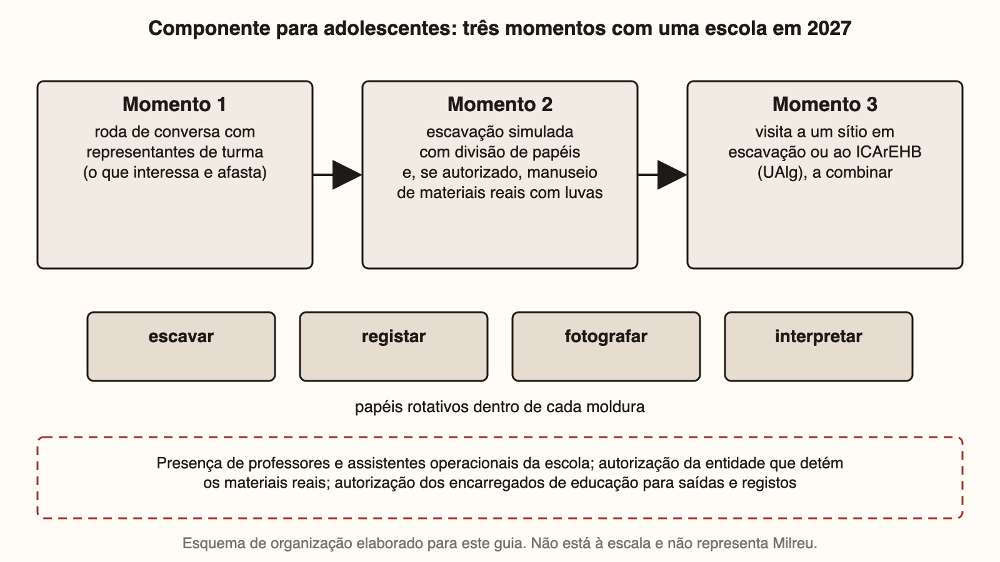

> © 2026 Fernando Rodrigues de Jácomo. Produzido no âmbito do Projecto Comunitário de Milreu. Consultar `RIGHTS.md`.

# Componente D. Componente para adolescentes

## 1. A actividade

A componente D é uma adaptação especial do Circuito para alunos adolescentes, criada para perceber o que interessa e o que afasta este público e para experimentar formas de o envolver. O ponto de partida é uma dificuldade conhecida: outros projectos de educação patrimonial em Portugal relatam que os alunos mais velhos são os mais difíceis de envolver, e o Circuito, concebido sobretudo a partir das estações físicas, corre o risco de lhes parecer uma actividade para crianças.

A componente reúne cinco acções, propostas pelo investigador. A primeira é a escavação simulada com divisão de papéis: os alunos trabalham nas molduras da estação 1, cada um com uma função definida e rotativa (escavar, registar, fotografar, interpretar), como numa equipa de campo. A segunda é uma visita a um sítio arqueológico em escavação, para verem como trabalha uma equipa real. A terceira é uma visita a um centro de investigação, com os seus laboratórios e equipamentos; o centro indicado é o ICArEHB, um centro de investigação da Universidade do Algarve, sediado na Faculdade de Ciências Humanas e Sociais, com laboratórios de arqueologia, e a visita é exequível, porque o projecto é um doutoramento da mesma universidade, mas a data, o grupo, as condições e o responsável do lado do centro ainda não estão definidos. A quarta é uma roda de conversa sobre património com representantes de turma, para recolher ideias e saber o que os alunos pensam. A quinta é a apresentação de materiais arqueológicos reais, manuseados com luvas, com a presença de professores e de assistentes operacionais da escola.

Estas acções organizam-se em três momentos com uma escola do concelho, ao longo de 2027. A roda de conversa vem primeiro, porque não precisa de material e permite perceber o que interessa antes de investir no resto; segue-se a escavação com papéis e, se houver autorização, o manuseio de materiais reais; e, por fim, a visita ao sítio em escavação ou ao centro de investigação. A escola ainda não está escolhida, e os meses dos três momentos serão marcados com ela, tendo em conta o calendário escolar.

O material próprio desta componente é pouco, porque a escavação usa as molduras da estação 1: cartões de papéis, um por função e por moldura; fichas de registo para os alunos; materiais simples para a roda de conversa, como papel de cenário, marcadores e notas adesivas; luvas de nitrilo de tamanhos juvenil e adulto e tabuleiros forrados para o manuseio. Os materiais arqueológicos reais não são do projecto: pertencem a uma entidade detentora, que terá de os ceder e de autorizar o manuseio, com as suas regras de conservação. As visitas exigem transporte, e a forma de o assegurar (pela escola, pelo Município ou com financiamento do Circuito) ainda não está decidida. A componente só entra no cenário com apoio.

A componente responde directamente ao primeiro dos três problemas que deram origem ao Circuito, a pouca participação dos estudantes do concelho na vida das ruínas, que o investigador retirou das entrevistas de 2024. A sua realização depende da política de trabalho com menores descrita no capítulo final, porque inclui saídas, registo de opiniões e, eventualmente, imagens de alunos.

## 2. Dinâmica geral e objectivos da actividade

A componente tem dois objectivos, um de investigação e outro educativo. O de investigação é identificar as restrições e os interesses do público adolescente em relação ao património e a actividades como as do Circuito: o que os atrai, o que os aborrece, o que consideram infantil, o que gostariam de fazer. O educativo é dar aos alunos um contacto com a arqueologia que reconheçam como sério e real, com responsabilidades, com instrumentos de trabalho e com pessoas que fazem investigação.

O primeiro momento, a roda de conversa, reúne os representantes de turma, os delegados e subdelegados eleitos, com o investigador e, se a escola o desejar, um professor. A conversa parte de perguntas abertas sobre o património do concelho, sobre Milreu e sobre o que os alunos gostariam de fazer. O registo é feito por escrito e sem identificar quem disse o quê, e serve dois fins: orientar os momentos seguintes e devolver à escola uma síntese. Os representantes de turma levam a conversa às suas turmas e podem trazer ideias delas. É uma forma de participação, além de consulta, porque o que os alunos disserem pode mudar o que se faz a seguir.

O segundo momento é a escavação simulada com papéis. Cada grupo de cinco ou seis alunos tem uma moldura e um mediador; dentro do grupo, as funções rodam a meio da sessão, para que todos experimentem pelo menos duas. Quem escava trabalha por quadrantes; quem regista preenche a ficha de proveniência e mede a posição dos achados; quem fotografa documenta cada achado no lugar, antes de ser retirado; quem interpreta reúne as observações e propõe, no fim, uma leitura do contexto, que o grupo discute. Os contextos são propositadamente ambíguos, para que a pergunta central seja «que evidência falta para confirmar a vossa hipótese?», como prevê a estação 1 para os 15 a 17 anos.

No mesmo momento, se houver autorização da entidade detentora, os alunos manuseiam materiais arqueológicos reais. O manuseio faz-se com luvas, sobre tabuleiros forrados, com instruções de conservação dadas antes, por escrito e oralmente, e com a presença de professores e de assistentes operacionais da escola, que acompanham o grupo; se a entidade detentora enviar um técnico, as suas regras prevalecem. O contraste entre a réplica impressa da moldura e o objecto real é, em si, um tema de conversa: o que se sabe deste objecto, quem o encontrou, como se sabe que é romano.

O terceiro momento é uma saída de campo organizada pela escola, a um sítio arqueológico em escavação, com autorização do arqueólogo responsável e regras de segurança, ou ao ICArEHB, nas condições que o centro definir. A visita mostra o trabalho real que as estações simulam e as pessoas que o fazem. A Universidade do Algarve é a instituição do doutoramento de que o projecto faz parte, o que torna a visita ao centro uma ligação natural entre a escola e a investigação.

Os objectivos propostos, a verificar com a escola parceira, são: recolher, na roda de conversa, as opiniões dos representantes de turma sobre património e sobre o Circuito; obter participação activa na escavação com papéis, com cada aluno a desempenhar pelo menos duas funções; e perceber, no fim dos três momentos, se o interesse dos alunos mudou e porquê. Nenhum destes objectivos tem resultado ainda.

## 3. Proposta por grupos de idade e quantidade de pessoas por actividade

| Acção | Idades | Pessoas | Mediadores e acompanhantes | Duração |
|---|---|---|---|---|
| Roda de conversa | 11–14 e 15–17 | representantes das turmas envolvidas | investigador; professor, se a escola o desejar | a fixar com a escola |
| Escavação com papéis | 11–14 e 15–17 | turma de 25–30, em grupos de 5–6 por moldura | um mediador por moldura; professores | 20–35 min por ronda, como na estação 1 |
| Manuseio de materiais reais | 11–14 e 15–17 | pequenos grupos, à vez | investigador; professores e assistentes operacionais; técnico da entidade detentora, se esta o indicar | a fixar com a entidade detentora |
| Visita a sítio em escavação | 11–14 e 15–17 | turma ou grupo definido pela escola | arqueólogo responsável da escavação; professores | a fixar com a escavação |
| Visita a centro de investigação | 11–14 e 15–17 | turma ou grupo definido pela escola | equipa do centro; professores | a fixar com o centro |

A componente dirige-se aos grupos de 11 a 14 e de 15 a 17 anos; o intervalo exacto dependerá da escola parceira e das turmas que nela participarem. Os interesses dos dois grupos são diferentes, e a roda de conversa deve servir também para os distinguir.

O número de pessoas é o de uma turma nas acções de escola, e o de um pequeno grupo de representantes na roda de conversa. A presença de professores e de assistentes operacionais da escola é condição, e não apoio opcional, nas acções com materiais reais e nas saídas. Em eventos abertos, só a escavação com papéis é possível; as visitas e o manuseio não cabem nesse formato.

## 4. Propostas alternativas e adicionais

Se não houver autorização para manusear materiais reais, o segundo momento faz-se só com a escavação com papéis, e o contacto com objectos reais passa para a visita ao centro de investigação, se o centro o puder oferecer. Se não for possível visitar um sítio em escavação, a visita ao centro de investigação substitui-a; para alunos que não possam aceder a uma escavação, por desníveis ou valas, é também a alternativa.

Propõe-se que a equipa das Ruínas Romanas de Milreu possa ajudar na mediação e disponibilizar espaço no sítio, e que uma das sessões, por exemplo a roda de conversa, decorra nas ruínas, se a equipa o acordar; como principal parte interessada do Circuito, a equipa deve ser informada do que os adolescentes disserem sobre o sítio. A oficina de estratigrafia, com perfis perturbados, pode completar a escavação com papéis numa sessão mais longa. O passaporte poderia dar um carimbo extra pela visita a um centro de investigação ou a uma escavação, possibilidade a avaliar. E os alunos mais velhos podem ser convidados a escrever perguntas para o quiz, com fonte, ou a testar e criticar o jogo digital de mosaicos.

## 5. Resultados esperados

Espera-se, no fim dos três momentos, um registo das opiniões dos representantes de turma sobre o património e sobre as actividades, uma participação activa da turma na escavação com papéis e uma avaliação, com a escola, do que funcionou e do que não funcionou com este público. O resultado mais importante é de conhecimento: saber, com base na experiência com uma escola, o que o Circuito tem de mudar para envolver adolescentes. Estas expectativas dependem de encontrar uma escola parceira, de obter as autorizações e de o calendário escolar o permitir; nenhuma está verificada.

## 6. Limitações

A componente depende de várias autorizações, nenhuma das quais existe: da escola, para as três acções; dos encarregados de educação, para as saídas, para a recolha das conversas e para qualquer imagem; do arqueólogo responsável e do dono da obra, para a visita a uma escavação, com regras de segurança e seguro; do centro de investigação, para a visita; e da entidade detentora, para o manuseio de materiais reais, com regras de conservação que o projecto não pode decidir sozinho. O transporte das visitas não tem solução decidida. A escola parceira e os meses ainda não estão definidos.

Há também uma limitação de conhecimento: as fontes consultadas confirmam o problema, a dificuldade de envolver adolescentes, mas não testaram nenhuma das soluções propostas. A componente é, por isso, também um pequeno estudo, cujos resultados podem mostrar que alguma das acções não funciona.

## 7. Adaptações para participantes com restrições

A roda de conversa exige ouvir e falar em grupo; para alunos surdos ou que tenham dificuldade em falar em público, há texto de apoio com as perguntas e a possibilidade de intervir por escrito ou com notas adesivas. A interpretação em língua gestual portuguesa não faz parte da proposta principal e só será considerada se a escola o pedir e for possível organizá-la. As escavações reais têm desníveis, valas, calor e piso irregular, e o acesso em cadeira de rodas é improvável; para estes alunos, a visita ao centro de investigação é a alternativa, sem se afirmar que substitui a experiência no terreno. A escavação simulada segue as adaptações da estação 1, incluindo a modalidade sobre mesa acessível e a participação por indicação verbal. No manuseio de materiais reais, um aluno cego pode tocar o objecto com luvas, se a entidade detentora o permitir, acompanhado da descrição oral.

## 8. Embasamento teórico

O problema que a componente quer tratar está documentado em dois projectos recentes. O Blue Voices, que levou maletas pedagógicas sobre património subaquático a escolas do Algarve entre novembro de 2025 e maio de 2026, observou que os alunos do ensino secundário foram os mais difíceis de envolver, e que as ilustrações para interpretação em grupo funcionaram sobretudo até aos 15 anos (Lopes e Baço 2026, p. 1947). No ARQUEOLAB, a actividade apresentada na Noite Europeia dos Investigadores de 2025, os participantes dos 11 aos 17 anos foram o único grupo em que a resposta «sim» à pergunta sobre o que tinham aprendido superou a resposta mais positiva, «muito» (Vale et al. 2026, pp. 1865–1866); é um sinal fraco, porque resulta de um questionário curto e de um número pequeno de respostas nessa faixa, mas aponta no mesmo sentido.

O ARQUEOLAB oferece ainda um precedente parcial para o manuseio de materiais reais: a sua segunda actividade usou alguns artefactos arqueológicos verdadeiros, ao lado de réplicas impressas em 3D e de réplicas artesanais, mas o artigo não descreve as regras de manuseio (Vale et al. 2026, p. 1864, nota 9). Para a divisão de papéis e a participação de não-arqueólogos no trabalho, o *Community Archaeology Project* de Quseir, no Egipto, onde a população local participou em colaboração, formação e apresentação pública, é uma referência por analogia, e não um estudo com adolescentes (Moser et al. 2002).

As soluções propostas na componente, a roda de conversa com representantes de turma, a escavação com papéis, o manuseio de materiais reais e as visitas a escavações e a centros de investigação, não têm precedente avaliado nas fontes lidas. A sociologia da infância que o projecto usa noutras componentes também não ajuda aqui: Corsaro (2015) declara no prefácio da sua obra que a cobertura das culturas de pares termina por volta dos 12 anos, e não trata adolescentes. A componente é, por isso, assumida como experimental, e a sua avaliação faz parte da própria actividade.

## 9. Bibliografia de referência

As obras citadas neste capítulo constam da bibliografia de referência, no final do guia.

